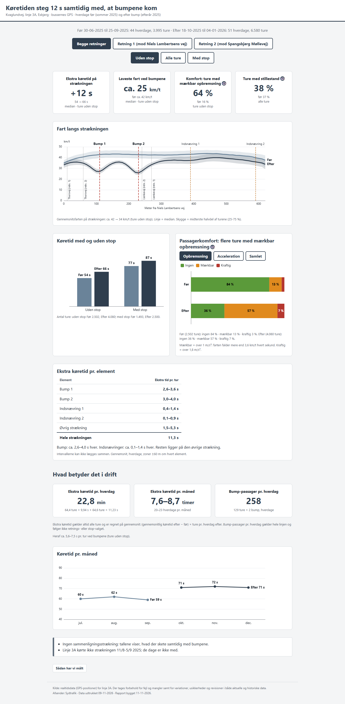

# Trackpoint-værktøjet

Værktøjet måler bussers køretid, fart og passagerkomfort på en strækning ud fra bussernes
GPS-positioner og laver en rapport som én HTML-fil, du kan sende videre. Det kører på Windows,
og du skriver ingen kommandoer: du udfylder en fil og dobbeltklikker.



## Det kan bruges til

- **Før og efter en ændring** på vejen, fx bump, indsnævringer eller en ny hastighedsgrænse.
- **Én periode:** hvordan der køres på en strækning i dag (fart, opbremsning, acceleration, hvor
  bussen standser).
- **Køretid gennem et kryds**, stykke for stykke (før køen, stoplinjen, i krydset, efter krydset).
  Det kræver den fulde config; se [program/README.md](program/README.md), "Kryds".

**Data:** værktøjet er udviklet og afprøvet med eksport fra HAFAS (`Details.csv` og `List.csv`).
GPS-data fra andre systemer skal først have de samme kolonner
([eksportvejledningen](vejledning/eksportvejledning_HAFAS.md), afsnit 4); det er ikke afprøvet.


## Kom i gang

### 1. Installér Python (én gang)

Hent Python 3.10 eller nyere fra [python.org](https://www.python.org/downloads/), og sæt hak i
**"Add python.exe to PATH"** under installationen. Værktøjet er testet med Python 3.10 og 3.13.

### 2. Hent værktøjet

- **Uden git:** gå til [Releases](https://github.com/Sydtrafik/Bus_gps_trackpoint_analyse/releases/latest),
  og hent **Source code (zip)**. Pak zip-filen ud i en mappe, du selv kan skrive i. Mappens sti
  må ikke indeholde `%`.
- **Med git:** `git clone https://github.com/Sydtrafik/Bus_gps_trackpoint_analyse.git`

Kommer der en ny version, erstatter du hele værktøjsmappen. Dine analyser ligger ved siden af
den og røres ikke.

### 3. Lav en analyse

0. **I god tid:** eksportér før-perioden fra HAFAS, før ændringen sker. HAFAS gemmer kun ca.
   3 måneder. Se [eksportvejledningen](vejledning/eksportvejledning_HAFAS.md).
1. **Dobbeltklik på `ny_analyse.bat`**, og skriv et navn (fx Kvaglundvej Esbjerg). Den opretter
   `trackpoint_analyser\<navn>\` ved siden af værktøjsmappen:

   ```
   data\A\                          HAFAS-eksporten for før-perioden (Details.csv og List.csv)
   data\B\                          HAFAS-eksporten for efter-perioden
   config.yaml                      indstillinger, du udfylder
   koer_analyse.bat                 kører analysen
   Vejledning - trin for trin.txt   de samme trin som her
   resultat\                        tal og rapport
   ```

2. **Åbn `config.yaml`** i Notesblok, og udfyld felterne mærket `<-- UDFYLD`: perioder,
   strækningens to ender (koordinater fra Google Maps) og bump eller indsnævringer.
3. **Dobbeltklik på `koer_analyse.bat`**, og vælg:

   ```
   0  første gang: installér pakker og test (ca. 1 min)
   1  stoppesteder pr. retning, med forslag til, hvad du skriver i config.yaml
   2  prøvekørsel på 300 ture: tjek, at næsten alle ture er beholdt
   3  fuld analyse og rapport (10-30 min)
   4  byg rapporten igen, når du har rettet titel og tekster i config.yaml
   5  tilføj din konklusion til de nationale analysekonklusioner (efter 6)
   6  lav din konklusionsfil med rapportens nøgletal (resultat\konklusion.yaml)
   ```

4. **Læs rapporten** i `resultat\rapport.html`. Køretiden pr. tur står også i
   `resultat\turtabel.csv` og pr. time i `resultat\overblik.md`. Forbehold og hvordan tallene er
   regnet: [metode_og_rapportering.md](vejledning/metode_og_rapportering.md).
5. **Del dine fund:** valg 6 laver `resultat\konklusion.yaml` med rapportens nøgletal. Udfyld
   felterne med `UDFYLD` (vej, by, bustype, kontakt m.m.), og vælg 5: filen tjekkes og lægges i
   værktøjets [analyser/](analyser), og oversigten laves igen. Del den med en pull request eller et
   issue (se [CONTRIBUTING.md](CONTRIBUTING.md)). Filen er offentlig, så skriv ingen mailadresser.


## Hvad skal jeg læse, og hvornår

| Når | Læs |
|---|---|
| Før ændringen sker | [eksportvejledning_HAFAS.md](vejledning/eksportvejledning_HAFAS.md) |
| Før du deler en rapport | [metode_og_rapportering.md](vejledning/metode_og_rapportering.md): hvad tallene betyder, forbehold |
| Når du skriver rapportens tekst | [formidling_og_grafik.md](vejledning/formidling_og_grafik.md) |
| Når analysen skal bruges i en sag om vejregler | [vejledning/kilder/README.md](vejledning/kilder/README.md) |
| Flere strækninger, kryds, fejlfinding | [program/README.md](program/README.md) (teknisk reference) |


## Hvad ligger her

| Fil eller mappe | Indhold |
|---|---|
| `ny_analyse.bat` | Start her: opretter en mappe til din analyse |
| [nationale_analysekonklusioner.md](nationale_analysekonklusioner.md) | Konklusioner fra analyser i hele landet som tabel (laves ud fra `analyser/`) |
| `nationale_analysekonklusioner.html` | De samme konklusioner med graf, sortérbar tabel med filtre, tegning af fartdæmperen og et vejkort pr. analyse (virker uden internet). Åbn den lokalt i en browser; GitHub viser kun kildekoden. |
| [analyser/](analyser) | Én fil pr. analyse; tilføj din her ([analyser/README.md](analyser/README.md)) |
| [vejledning/](vejledning) | Vejledninger (se ovenfor) |
| [program/](program) | Selve programmet; ret ikke i det |
| [AGENTS.md](AGENTS.md), `CLAUDE.md` | Til en AI-agent (fx Claude Code), hvis du bruger en |
| [CONTRIBUTING.md](CONTRIBUTING.md) | Sådan deler du en ændring eller dine konklusioner |
| [LICENSE](LICENSE), [THIRD_PARTY_NOTICES.md](THIRD_PARTY_NOTICES.md) | Licens (MIT) og licenser for de medfølgende biblioteker |

Version: [program/VERSION](program/VERSION). Ændringer: [program/CHANGELOG.md](program/CHANGELOG.md).


## Spørgsmål, fejl og bidrag

Opret et [issue](https://github.com/Sydtrafik/Bus_gps_trackpoint_analyse/issues/new/choose): vælg
"Fejl" eller "Ny analysekonklusion". Ændringer af værktøjet sendes som pull request; se
[CONTRIBUTING.md](CONTRIBUTING.md). Repoet vedligeholdes af Sydtrafik.


## Licens og forbehold

- Koden er udgivet under MIT-licensen (se [LICENSE](LICENSE)). ECharts følger med under sin egen
  licens, og vejkortene (`analyser/kort/`, `vejkort.json`) er OpenStreetMap-data under ODbL
  (se [THIRD_PARTY_NOTICES.md](THIRD_PARTY_NOTICES.md)).
- Rapporten virker uden internet. Slår du kortet til (`kort: true` i `config.yaml`), henter
  `byg_rapport.py` vejdata fra OpenStreetMap én gang, når rapporten bygges; læseren henter intet.
- HAFAS er et varemærke, der tilhører sin ejer. Værktøjet læser kun en eksport fra HAFAS og er
  ikke tilknyttet eller godkendt af ejeren.
