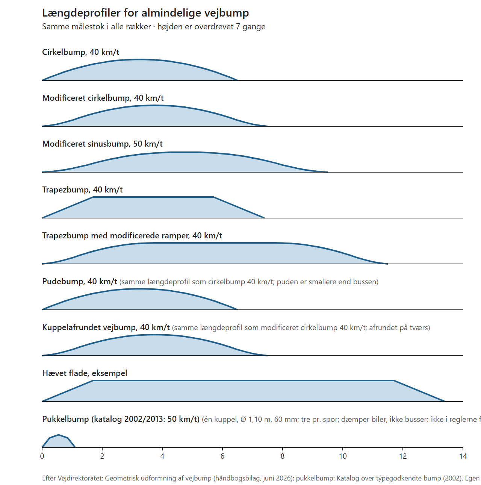

# Nationale analysekonklusioner: trackpoint-analyser i hele landet

Konklusioner fra afsluttede analyser med værktøjet i hele landet, så vi kan lære af hinandens fund: hvilke vejændringer der er målt, hvordan, og hvad der kom ud af det.

**Senest opdateret:** 2026-11-19 af Sydtrafik (Kvaglundvej: sinusbump, ikke cirkelbump)

Filen ligger i værktøjets repo på GitHub og er offentlig. Den deles via repoet, ikke pr. mail.

## Sådan tilføjer du din analyse

1. **Når din rapport er færdig:** kopiér skabelonen nederst, udfyld den for din analyse og sæt den øverst under "Analyser" (nyeste først). Tilføj en række i oversigtstabellen, sæt dagens dato i "Opdateret" (i blokken og i tabellen), og ret "Senest opdateret". Ret kun din egen blok, ikke andres.
2. **Lav visningen igen:** valg 5 i din analyses `koer_analyse.bat` (eller `python program\lav_konklusioner_html.py`). Den skriver `nationale_analysekonklusioner.html` ved siden af denne fil: tabel med søgning og filtre, et kort pr. analyse med tegning af bumptypen, og alle bumptegninger. Skriv "Type bump" med betegnelserne fra skabelonen, så tegningen findes. Ret aldrig i HTML-filen; den laves ud fra denne fil.
3. **Del den via GitHub:** lav en pull request med begge filer (`.md` og `.html`). Bruger du ikke git, så opret et issue i repoet med din udfyldte blok; så lægger en vedligeholder den ind.
4. **Kontakt:** skriv dit GitHub-brugernavn og, hvis du vil, dit navn og din organisation. Det, du skriver, bliver offentligt og kan ikke slettes fra repoets historik. Ingen mailadresser eller telefonnumre. Spørgsmål til en analyse stilles som et issue i repoet med brugernavnet nævnt.
5. **Nyeste version:** hent den fra repoet (`git pull`, eller download filerne). HTML-filen kan åbnes direkte i en browser uden værktøjet. Indtil pakke 1.3.0 hed filen `analyseoverblik.md`; har du den, så slet den.
6. **Kun aggregerede fund.** Ingen rådata, tur-id'er, chaufførnumre eller GPS-udtræk i filen.

Bruger du en kodeagent, så står opgaven også i `AGENTS.md` (agenten udfylder blokken og laver pull requesten eller issue-teksten; du godkender, før den sendes).

Bumptyper og regler: [kilder/README.md](vejledning/kilder/README.md) har gældende vejregler, ældre målinger og tegninger af hver bumptype ([kilder/bumptyper/](vejledning/kilder/bumptyper/)), som kan bruges i rapporter.



## Oversigt

| Vej, by | Ændring | Periode(r) | Bustype | Køretid (median, uden standsning ved stop) | Komfort (uden standsning ved stop, andel ture) | Kontakt | Opdateret |
|---|---|---|---|---|---|---|---|
| Kvaglundvej, Esbjerg | 2 sinusbump + 2 indsnævringer, 50 → 40 km/t | 2025: før 30/6–25/9, efter 18/10–4/1 | elbusser (alle) | 54 → 66 s (+12 s) på 626 m | mærkbar opbremsning 16 → 64 %, mærkbar acceleration 18 → 47 % | Sydtrafik | 2026-11-19 |

## Analyser

### Kvaglundvej, Esbjerg (2025)

| Felt | Værdi |
|---|---|
| Opdateret | 2026-11-19 |
| Vejnavn og strækning | Kvaglundvej, 626 m fra Niels Lambertsens Vej til Spangsbjerg Møllevej |
| By | Esbjerg |
| Kort | [Strækningen i Google Maps](https://www.google.com/maps/dir/?api=1&origin=55.48041,8.46749&destination=55.48511,8.47295&travelmode=driving) |
| Vejtype | Gennemkørselsvej i boligkvarter |
| Linje(r) | Bybus 3A, begge retninger (ca. 129 ture pr. hverdag) |
| Bustype | Elbusser, alle ture (oplyst af Sydtrafik). Længde ikke oplyst. HAFAS-eksporten har kun busnummer: alle ture med kendt busnummer på nær 25 er kørt af busnummer 8011–8043, og 38 af bussene kørte i begge perioder. |
| Ændring | 2 bump og 2 indsnævringer anlagt 26/9–17/10 2025; hastighedsgrænsen sat ned fra 50 til 40 km/t |
| Type bump | Sinusbump (oplyst af Sydtrafik 2026-11-19; tidligere angivet som cirkelbump eller modificeret cirkelbump). Vejreglernes bilag har ingen almindelig sinusbump, kun modificeret sinusbump til 50 km/t, så pakken har ingen tegning af typen. |
| Sammenligning med vejregler | Den laveste målte busfart ved bumpene var ca. 25 km/t efter. Håndbogsbilaget angiver ingen passagehastighed for almindelige sinusbump (kun for modificeret sinusbump til 50 km/t: 35 km/t), så den målte fart er ikke sammenlignet med en vejregel for typen. Håndbog Fartdæmpere anbefaler at undgå bump på veje med busser i fast rute. Kilder: `kilder/README.md`. |
| Antal bump og placering | 2: ved 110 m og 230 m fra Niels Lambertsens Vej |
| Indsnævring | Ja, 2 (ved 395 m og 597 m), anlagt samtidig med bumpene |
| Sving | Nej, ret strækning |
| Hastighedsbegrænsning | Ændret fra 50 til 40 km/t |
| Stoppesteder på strækningen | 2 (Thorsvej, Lærkevej), ét på hver side af vejen |
| Perioder for data | Før: 30/6–25/9 2025 (44 hverdage, 3.995 ture). Efter: 18/10 2025–4/1 2026 (51 hverdage, 6.580 ture). Anlægsperioden 26/9–17/10 er ikke med. |
| Udeladte dage | 11/8–5/9 2025: linje 3A kørte omkørsel og kom ikke forbi strækningen. Weekender og helligdage. |
| Analyse på trackpoint eller stoppoint | Trackpoint (GPS-positioner ca. hvert 1,6–2 s). Stoppoint-rækker bruges ikke: deres tidsstempel ligger 8–9 s efter passagen. Ture, hvor et målepunkt kun ramte en stoppoint-række, er udeladt. |
| Data med og uden standsning ved stop | Begge. Hovedtal er ture **uden standsning ved stop** (bussen kommer ikke under 3,6 km/t på strækningen): 2.502 før / 4.080 efter. Med standsning ved stop: 1.493 / 2.500 ture. Andelen med standsning var den samme før og efter (37 % / 38 %). Mindst 99 % af turene med standsning holdt ved et stoppested. |
| Fund: køretid | Uden standsning ved stop: median 54 → 66 s (+12 s). Med standsning ved stop: 77 → 87 s (+10 s). |
| Fund: fart | Laveste fart ved bumpene ca. 42 → 25 km/t. Gennemsnitsfart på strækningen (uden standsning ved stop) 42 → 34 km/t. |
| Fund: komfort (opbremsning og acceleration langs vejen) | Andel ture uden standsning ved stop (mærkbar = over 1 m/s² i mindst 2 s, kraftig medregnet; kraftig = over 1,8 m/s²). Opbremsning: mærkbar 16 → 64 %, kraftig 3 → 7 %. Acceleration: mærkbar 18 → 47 %, kraftig 3 → 5 %. Samlet (opbremsning eller acceleration): mærkbar 24 → 72 %, kraftig 5 → 10 %. Til sammenligning, ture med standsning ved stop før → efter: opbremsning mærkbar 99,7 → 98,8 %, kraftig 77 → 64 %; acceleration mærkbar 99,0 → 98,8 %, kraftig 60 → 50 %. En almindelig standsning ved stop er altså næsten altid mærkbar og oftest kraftig, så en mærkbar opbremsning svarer til det niveau, et almindeligt stop næsten altid når. Måler kørslen på hele strækningen, ikke stødet over selve bumpet. |
| Fund: ekstra tid pr. element (uden standsning ved stop, gennemsnit pr. tur, interval) | Bump 1: 2,6–3,6 s. Bump 2: 3,0–4,0 s. Indsnævring 1: 0,4–1,4 s. Indsnævring 2: 0,1–0,9 s. Øvrig strækning: 1,5–5,3 s. I alt +11,3 s. Intervallerne kan ikke lægges sammen. |
| Fund: drift | Ca. 23 min ekstra køretid pr. hverdag for linje 3A, ca. 8 timer pr. måned. |
| Forbehold | Ingen sammenligningsstrækning: tallene viser, hvad der skete samtidig med bumpene. Bump, indsnævringer og den lavere hastighedsgrænse kom på samme tid, så tallene kan ikke skille deres virkning ad; ekstra tid pr. element fordeler tiden på steder langs vejen, ikke på årsager. |
| Rapport | Præsentationsrapport (HTML), lavet til et oplæg 11/11 2026. |
| Værktøjsversion | analyse_v2.1, komfort_v1.1, zonetid 1.1 |
| Kontaktperson | Sydtrafik (GitHub: AFT-syd) |

---

## Skabelon (kopiér, udfyld, og sæt øverst under "Analyser")

```markdown
### <Vejnavn>, <by> (<år>)

| Felt | Værdi |
|---|---|
| Opdateret | <ÅÅÅÅ-MM-DD> |
| Vejnavn og strækning | <vej>, <længde> m fra <punkt> til <punkt> |
| By | |
| Kort | <link til strækningen i Google Maps, fx https://www.google.com/maps/dir/?api=1&origin=<lat>,<lon>&destination=<lat>,<lon>> |
| Vejtype | <fx gennemkørselsvej i boligkvarter, boligvej, trafikvej, landevej> |
| Linje(r) | <linje, retninger, ture pr. hverdag> |
| Bustype | <drivmiddel (diesel, el, biogas/HVO) og længde (midibus, solobus 12-13 m, ledbus 18 m); samme bustyper før og efter? HAFAS-eksporten har kun busnummer (List.csv, kolonnen "Busnummer"), så slå numrene op i vognparken. Skriv "ikke oplyst", hvis du ikke kan finde det.> |
| Ændring | <hvad blev ændret, og hvornår (anlægsperiode)> |
| Type bump | <betegnelse fra håndbogsbilaget: cirkelbump, modificeret cirkelbump, modificeret sinusbump, trapezbump, trapezbump med modificerede ramper, hævet flade, pudebump, kuppelafrundet, præfabrikeret, pukkelbump (ældre type); "ingen bump". Skriv "ikke bekræftet", hvis typen er antaget. Tegninger: kilder/bumptyper/> |
| Sammenligning med vejregler | <målt busfart ved bumpet mod passagehastigheden for bumptypen; relevante anbefalinger. Kilder: vejledning/kilder/README.md> |
| Antal bump og placering | <antal; meter fra strækningens start> |
| Indsnævring | <ja/nej, antal, placering; nye eller eksisterende> |
| Sving | <ja/nej; værktøjets komfortmål kræver en ret strækning> |
| Hastighedsbegrænsning | <før / efter, km/t, og hvornår den blev ændret> |
| Stoppesteder på strækningen | <antal, navne> |
| Perioder for data | <før: datoer, hverdage, ture; efter: datoer, hverdage, ture; eller kun én periode> |
| Udeladte dage | <omkørsel, anlæg, helligdage m.m.> |
| Analyse på trackpoint eller stoppoint | <trackpoint (GPS-positioner) / stoppoint (stoprækker) / begge, og hvorfor> |
| Data med og uden standsning ved stop | <hvilke grupper der er rapporteret, antal ture i hver; holdt bussen stille andre steder end ved stoppesteder (kø, signal)?> |
| Fund: køretid | <median før → efter, med og uden standsning ved stop> |
| Fund: fart | <laveste fart ved elementerne, gennemsnitsfart> |
| Fund: komfort (opbremsning og acceleration langs vejen) | <andel ture med mærkbar og kraftig opbremsning, acceleration og samlet, før → efter, uden standsning ved stop, og til sammenligning ture med standsning ved stop. Tallene står i rapportens komfort-afsnit.> |
| Fund: ekstra tid pr. element | <interval pr. element og øvrig strækning> |
| Fund: drift | <ekstra minutter pr. hverdag / timer pr. måned> |
| Forbehold | <sæson, sammenligningsstrækning, datahuller> |
| Rapport | <rapporttype, til hvem> |
| Værktøjsversion | <fx analyse_v2.2, komfort_v1.1, zonetid 1.1> |
| Kontaktperson | <GitHub: brugernavn; navn og organisation er valgfrie>; ingen mail eller telefon, filen er offentlig |
```
