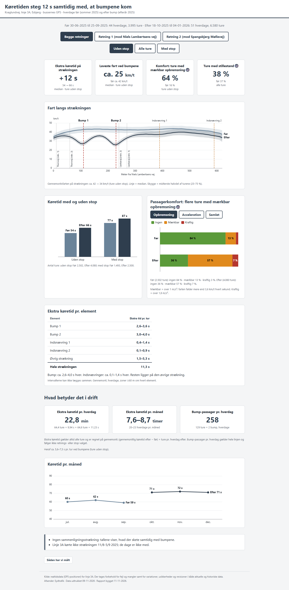
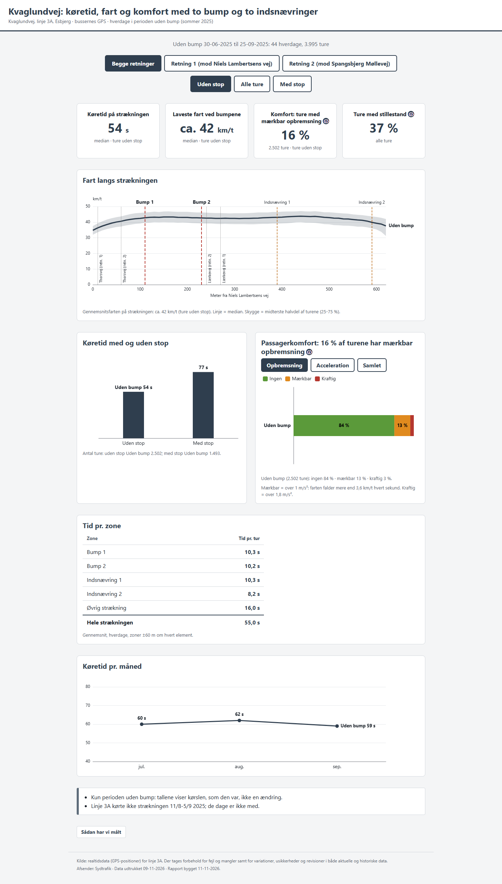

# Trackpoint-værktøj: køretid, fart og kørselskomfort ved vejændringer

**Version:** se filen `VERSION` (ændringer i [CHANGELOG.md](CHANGELOG.md); sådan opdateres og flettes pakken: afsnit 11).

Python-værktøj fra Sydtrafik, pakket til deling. Det måler bussers **køretid**, **fart** og **kørselskomfort** på en strækning ud fra realtids-GPS (eksport fra realtidssystemet HAFAS), før og efter en vejændring (vejbump, indsnævring m.m.) eller for én periode alene, fordeler den ekstra køretid på elementerne og laver en **selvstændig HTML-rapport** til at sende videre. Rapporten er en **præsentationsrapport med få fund og lidt interaktion**: få valgknapper (strækning, retning, med/uden standsning ved stop), ingen tabeller med rådata. Pakken er afprøvet på en analyse af to bump og to indsnævringer på Kvaglundvej i Esbjerg (bybus 3A, 2025).

**Anvendelser:**
- **Før og efter en vejændring** (hovedanvendelsen): ekstra køretid pr. element, fart og komfort.
- **Én periode, uden før-måling:** hvordan bussen påvirkes, og hvordan der køres på en strækning i dag: fartprofil, opbremsning og acceleration, og hvor bussen standser (afsnit "Én periode").
- **Køretid gennem et kryds** (kræver den fulde config, ikke den nemme vej): læg flere punkter langs bussens vej i én retning, fx et punkt et godt stykke før krydset (før køen), et ved stoplinjen, et ude i krydset, et på vejen efter krydset og evt. et længere ude. Brug kun den retning under `point_order` og `stops` (ture i den anden retning kasseres som `ingen_point_order_direction_<n>`), og én `distances`-linje pr. stykke. Så giver `result.csv` køretiden pr. stykke pr. tur, og `segmenter.csv` hvert ping med fart og tidspunkt. Punkterne matches på nærmeste ping i rækkefølge, så sving går fint; men komfort, fartprofil, zonetid og rapporten antager en ret strækning og skal ikke bruges her. Fokus er køretiden pr. stykke (p1-p2, p2-p3 osv.), ikke en beregnet ventetid. Vil man se, hvad trafikken koster, sammenligner man grupper af ture fra samme udtræk, fx tidspunkter med meget let og meget tung trafik; det er et valg i analysen og rapporten, ikke grænseværdier i beregningen. Den anden retning er sin egen køretid med egne punkter. `turtabel.py` giver køretid pr. stykke og tidspunkt ved hvert punkt i én række pr. tur og et overblik pr. time (trin 6b). `rapport\lav_kryds_rapport.py` laver en rapport (én HTML-fil) med køretid pr. stykke over døgnet, pr. rute og pr. planlagt tur, for én periode eller før/efter. Opsætning, config-skabelon og kommandoer: afsnittet "Kryds: køretid pr. stykke i én retning" under trin 10.
- **Pr. tur:** `turtabel.csv` (trin 6b) har én række pr. tur med periode, dato, ugedag, dagtype, time, retning, rute, planlagt turnummer, køretid pr. stykke og tidspunkt ved hvert punkt. Eneste kilde er HAFAS-eksporten (analysens output og `List.csv`); der slås ikke op i andre kilder. `overblik.md` viser køretiden pr. stykke pr. time og periode (median og p25-p75). Strækningsrapporten fordeler ikke på tid på dagen; det gør kryds-rapporten. Rådata og tur-id'er må ikke med i filer, der deles (AGENTS regel 3); `turtabel.csv` har tur-id og er til egen udforskning.

*Dette er den tekniske reference (i `program\`). Som bruger starter du med [README.md](../README.md) i værktøjsmappen.*

- **Ny bruger uden Python-erfaring:** følg afsnittet "Den nemme vej" nedenfor. Du skal kun bruge `ny_analyse.bat`, en `config.yaml` og en `koer_analyse.bat`. Ret ikke i filerne i værktøjsmappen (undtagen `nationale_analysekonklusioner.md`); dit arbejde ligger i din egen analysemappe.
- Skal du lave en rapport, så læs **[formidling_og_grafik.md](../vejledning/formidling_og_grafik.md)** først: rapporttype, budskab, titler, tekst, farver og tjekliste.
- Brug **[AGENTS.md](../AGENTS.md)**, hvis en kodeagent skal køre værktøjet: kommandoer i rækkefølge, verifikation, faldgruber.
- Læs **[metode_og_rapportering.md](../vejledning/metode_og_rapportering.md)** for, hvad vi rapporterede, hvordan det er regnet, og hvorfor vi valgte og fravalgte som vi gjorde (inkl. hvad komfortmålet er og ikke er).
- Eksport af data fra HAFAS: [eksportvejledning_HAFAS.md](../vejledning/eksportvejledning_HAFAS.md). Ændringshistorik: [CHANGELOG.md](CHANGELOG.md).



*Rapportskabelonen (neutral palette, uden kort) bygget på Kvaglundvej-data.*

## Planlægning: eksportér før-perioden i god tid

**HAFAS gemmer kun ca. 3 måneder tilbage.** En før-periode skal derfor eksporteres i god tid, **før ændringen sker**, ellers er den væk og kan ikke genskabes. Planlæg sådan:

1. Aftal før-perioden, så snart en ændring er besluttet. Eksportér den, mens data stadig findes, og gem filerne.
2. Vælg en før-periode, der ligner efter-perioden (samme årstid og køreplan, så vidt muligt) og har nok hverdage (på Kvaglundvej 44 hverdage før og 51 efter).
3. Eksportér efter-perioden senere, inden for de 3 måneder. Husk, at en anlægsperiode imellem ikke skal med.
4. Mangler du en før-måling, kan værktøjet stadig beskrive kørslen i perioden alene (afsnit "Én periode" nedenfor), men så uden sammenligning.

Eksportvejledning: [eksportvejledning_HAFAS.md](../vejledning/eksportvejledning_HAFAS.md).

## Den nemme vej: dobbeltklik i stedet for kommandoer

Kører på Windows og kræver Python (testet på 3.13; 3.10 eller nyere forventes at virke). Du skriver ingen kommandoer.

1. **Dobbeltklik på `ny_analyse.bat`** i værktøjsmappen, og skriv et navn (fx `Kvaglundvej Esbjerg`). Den opretter din analysemappe ved siden af værktøjet:
   ```
   trackpoint_analyser\Kvaglundvej Esbjerg\
   ├─ data\A\            ← HAFAS-eksporten for før-perioden (Details.csv og List.csv)
   ├─ data\B\            ← HAFAS-eksporten for efter-perioden
   ├─ config.yaml        ← udfyld felterne med  <-- UDFYLD
   ├─ koer_analyse.bat   ← dobbeltklik for at køre
   ├─ Vejledning - trin for trin.txt   ← de samme trin som her
   └─ resultat\          ← tal og rapport.html
   ```
2. **Læg eksporten** i `data\A` og `data\B` ([eksportvejledning_HAFAS.md](../vejledning/eksportvejledning_HAFAS.md)).
3. **Udfyld `config.yaml`** i Notesblok: perioder, strækningens to ender p1 og p2 (koordinater fra Google Maps) og elementerne. Hvert bump har en `radius_m`: hvor langt før og efter bumpet den laveste fart og største opbremsning måles. 30 m passer til et almindeligt enkelt bump; er bumpet udført anderledes (fx to forskudte bump, ét i hver vejbane), så sæt koordinaten midt imellem og en radius, der dækker begge. Resten kan stå.
4. **Dobbeltklik på `koer_analyse.bat`**, og vælg:
   - `0` første gang: installerer Python-pakkerne og tester værktøjet.
   - `1` stoppesteder: skriver `stopnavne.txt` med stoppestederne for hver retning i køreorden og et forslag til start- og slutstop for hver retning, klar til at kopiere ind i `config.yaml` (punkt 4). Navnene kan være forskellige i de to retninger og ligge forskelligt, så retningerne udfyldes hver for sig. Står der OBS nederst, kører retning 1 fra p2 mod p1: byt p1 og p2, og kør `1` igen.
   - `2` prøvekørsel på 300 ture. Tjek `resultat\proeve\kvalitet.md`: næsten alle ture skal være beholdt uden "flag afstand > 200 m". Står det ved næsten alle, så byt p1 og p2 i config. Står der "stop_ikke_fundet" ved næsten alle, så ret stopnavnene.
   - `3` fuld analyse og rapport (10-30 min). Rapporten åbner af sig selv. Køretiden pr. tur står i `resultat\turtabel.csv` (åbn i Excel eller Power BI) og pr. time i `resultat\overblik.md`.
   - `4` byg rapporten igen, efter du har skrevet titlen (hvad og hvor; et fund først, når det er verificeret) og teksterne i config.
5. **Læs rapporten** og forbeholdene i [metode_og_rapportering.md](../vejledning/metode_og_rapportering.md), og tilføj dine fund i [nationale_analysekonklusioner.md](../nationale_analysekonklusioner.md) (trin 10).

Kun én periode: sæt `PERIODER=A` øverst i `koer_analyse.bat`. Flyttes værktøjsmappen, så ret `VAERKTOEJ` samme sted. Flere strækninger i én analyse og alle andre muligheder kræver den fulde config: se `config_eksempel.yaml` og afsnit 4.

Ved en ny version af pakken erstatter du hele værktøjsmappen. Analysemapperne ligger ved siden af og røres ikke.

## Trinene bag: fra eksport til rapport

| Trin | Kommando | Giver |
|---|---|---|
| 1 | Eksportér `List.csv` og `Details.csv` fra HAFAS pr. periode | rådata (følger ikke med pakken) |
| 2 | Kopiér `config_eksempel.yaml`, ret perioder, stier, stopnavne, punkter, elementer | `min_config.yaml` |
| 3 | `analyse_v2.2.py --period A\|B --export-segments` | `result.csv`, `kvalitet.md`, `segmenter.csv` |
| 3b | `turtabel.py` | `turtabel.csv` (én række pr. tur til Excel/Power BI), `overblik.md`/`.csv` (køretid pr. stykke pr. time og periode) |
| 4 | `komfort_v1.1.py` | `komfort.csv` (komfort pr. tur; `komfort_<id>.csv` ved flere strækninger) |
| 5 | `zonetid.py` | `zonetid.json`/`.md` (ekstra køretid pr. element, interval; uden B: tid pr. zone) |
| 6 | `rapport\lav_rapportdata_v1.2.py` (bruger `turtabel.csv`) og `rapport\byg_rapport.py` | `rapport.html` (én fil, med valg for dage, rute og time) |
| 7 | Udfyld din blok i `nationale_analysekonklusioner.md`, og del den via repoet (pull request eller issue) | fælles samling af konklusioner (trin 10) |

Trin 3-6 kan køres med kun periode A: analyse af ét område uden sammenligning (afsnit "Én periode"). Flere strækninger i samme analyse: afsnit "Flere strækninger". Trin for trin: afsnit 4. Komplet kommandoliste med variabler: [AGENTS.md](../AGENTS.md).

## 1. Hvad værktøjet måler, og hvad det ikke måler

**Måler** (pr. tur, for en eller to perioder A og B, fx før og efter en vejændring):
- **Køretid** mellem to punkter på strækningen, i hele sekunder. Punkterne er koordinater, du selv vælger.
- **Hastighed ved hvert punkt** (km/t) og hvor langt det nærmeste GPS-ping lå fra punktet.
- **Datakvalitet:** hvor mange ture der blev kasseret og hvorfor, og hvilke dage der er (næsten) helt kasseret.
- **Passagerkomfort i kørslen på hele strækningen** (valgfrit trin): fartprofil, største opbremsning og acceleration langs vejen, antal hændelser over tærskler, stillestand, og fart/opbremsning i udvalgte vinduer (fx ved en fartdæmper) pr. tur på en ret strækning. Det er ikke stødet op og ned over selve bumpet.

**Måler ikke:**
- Årsager. Værktøjet siger, hvor meget køretid og hastighed ændrede sig, ikke hvorfor. Sæson, trafik, skolestart og køreplan er ikke korrigeret for; periodernes sammenlignelighed er dit ansvar.
- Rettidighed eller forsinkelse (kolonner om forsinkelse læses ikke).
- Vejlængde. Alle afstande er luftlinje (haversine) mellem GPS-position og punkt.
- Passagerernes oplevelse. Komfort er afledt af GPS-positioner (ingen accelerometer); tærsklerne kommer fra litteraturen om stående passagerer.
- Mere end to perioder pr. kørsel (A og B; B kan udelades). Andre kolonnenavne end HAFAS' egne (kolonnemapping findes ikke endnu).

Nøjagtighed og svagheder: afsnit 8.

## 2. Krav

- Windows. Testet på Python 3.13.0 (Windows 11); 3.10 eller nyere forventes at virke (syntaksen er tjekket mod 3.10, kørslen er ikke). Linux og macOS er ikke afprøvet (`.bat`-filerne er kun til Windows).
- `pandas`, `numpy`, `pyyaml`. Testet med pandas 2.2.3, numpy 2.2.5, pyyaml 6.0.2. `tqdm` er valgfri (fremdriftsbjælke). `pytest` er valgfri (testene kan køres uden).
- Installation: `python -m pip install -r requirements.txt` (fil i denne mappe).
- Rapporten kræver ingen ekstra pakker (ECharts og Leaflet ligger i `rapport\vendor\`). `playwright` er valgfri og bruges kun af browsertesten i `tests\test_rapport.py`.
- RAM: `analyse_v2.2.py` læser `Details.csv` i bidder og holder kun rækkerne mellem de to stop. Målt på en bærbar pc i 2026: højst 1,2-1,7 GB pr. periode ved ca. 9 mio. rækker (1,3-1,5 GB) og højst 2,2 GB ved 24 mio. rækker (3,4 GB). Den forrige `analyse_v2.1.py` holdt hele filen (ca. 6 GB ved 9 mio. rækker, ca. 20 GB ved 3,4 GB).
- Tid: ca. 4-8 min pr. periode ved 9 mio. rækker og ca. 9 min ved 24 mio. rækker, afhængigt af maskinen (to gennemløb af filen; v2.1 brugte ca. 2 min ved 9 mio. rækker). Hele kæden for to perioder (valg 3 i `koer_analyse.bat`): 16 min på Kvaglundvej. Testene: 1-4 min.
- Kommandoerne nedenfor er PowerShell (testet i PowerShell 7). Sæt `PYTHONUTF8=1`, så æ, ø og å ikke giver fejl.

## 3. Filer i mappen

Værktøjsmappens rod har kun det, brugeren selv rører. Alt andet ligger i `vejledning\` og `program\`.

| Sted | Fil | Hvad |
|---|---|---|
| rod | `README.md` | Kort vejledning til brugeren (forsiden på GitHub). |
| rod | `ny_analyse.bat` | Opretter en ny analysemappe (den nemme vej). |
| rod | `nationale_analysekonklusioner.md` | Konklusioner fra afsluttede analyser med værktøjet i hele landet: hver bruger tilføjer sine fund via repoet (trin 10). |
| rod | `nationale_analysekonklusioner.html` | Visning af konklusionsfilen: tabel med filtre, kort pr. analyse med bumptegning. Laves af `program\lav_konklusioner_html.py` (trin 10); ret ikke i den. |
| rod | `AGENTS.md`, `CLAUDE.md` | Instruktion til en kodeagent (`CLAUDE.md` peger på `AGENTS.md`). |
| `vejledning\` | `eksportvejledning_HAFAS.md` | Hvordan data eksporteres fra HAFAS, og hvilke kolonner der kræves. |
| `vejledning\` | `metode_og_rapportering.md` | Hvad der rapporteres, hvordan, og hvorfor. |
| `vejledning\` | `formidling_og_grafik.md` | Guide til rapporttype, budskab, titler, tekst, grafer, farver og tjek før deling. |
| `vejledning\` | `kilder\README.md`, `kilder\bumptyper\` | Gældende vejregler om bump og busser (status, version, indhold og bilag), ældre målinger af fart, G-påvirkning og chaufførpåvirkning, og tegninger af hver bumptype til rapporter. Læs den, før en analyse bruges i en konkret sag. |
| `program\` | `skabeloner\` | `config.yaml` (kort config med UDFYLD-felter), `koer_analyse.bat` (kører trinene med en menu), `ny_analyse.py` og `forbered.py` (stoppesteder pr. retning med forslag, og `resultat\config_beregnet.yaml` med bump-vinduer ud fra `radius_m`). `config.yaml` og `koer_analyse.bat` kopieres ind i analysemappen af `ny_analyse.bat`; ret dem ikke her. |
| `program\` | `analyse_v2.2.py` | Hovedværktøjet. Læser HAFAS-eksporten og config og skriver resultater. Læser store filer i bidder. |
| `program\` | `analyse_v2.1.py` | Forrige version med samme resultater; holder hele `Details.csv` i hukommelsen. Bliver i pakken som reference (afsnit 11). |
| `program\` | `komfort_v1.1.py` | Komfort-trin for en eller flere strækninger. Læser `segmenter.csv` fra hovedværktøjet. Bruger `komfort_v1.0.py` til beregningen. |
| `program\` | `komfort_v1.0.py` | Komfort-beregningen for én strækning. Den er verificeret og rettes ikke (afsnit 11), derfor er v1.1 en tynd indpakning om den og ikke en erstatning; begge skal være der. |
| `program\` | `turtabel.py` | Turtabel-trin: én række pr. tur (køretid pr. stykke, tidspunkt pr. punkt, time, ugedag, rute) og et overblik pr. time og periode. Ændrer ingen beregning. |
| `program\` | `zonetid.py` | Zonetid-trin: ekstra køretid fordelt på elementer og øvrig strækning, med interval. |
| `program\` | `rapport\lav_rapportdata_v1.2.py` | Samler `result.csv`, `komfort.csv`, `segmenter.csv`, `turtabel.csv`, `zonetid.json` og config til én `rapportdata.json`, også pr. dagtype, rute og time. Bruges af `koer_analyse.bat`. |
| `program\` | `rapport\lav_rapportdata.py` | Forrige version (v1.1, uden valg for dage, rute og time); samme tal i standardvalget. Bliver i pakken (afsnit 11) og bruges af analysemapper med en ældre `koer_analyse.bat`. |
| `program\` | `rapport\lav_kryds_rapport.py`, `rapport\kryds_skabelon.html` | Kryds-rapport: køretid pr. stykke over døgnet, pr. rute og pr. planlagt tur, ud fra `turtabel.csv`. Én selvstændig HTML-fil. |
| `program\` | `rapport\byg_rapport.py`, `rapport\skabelon_v1.2.html`, `rapport\skabelon.html` | Sætter `rapportdata.json` ind i skabelonen: én selvstændig HTML-fil. Skabelonen vælges efter datafilens version (v1.2 → `skabelon_v1.2.html`, v1.1 → `skabelon.html`). |
| `program\` | `rapport\vendor\` | ECharts (Apache-2.0) og Leaflet (BSD-2-Clause) med licensfiler. Indlejres i rapporten. |
| `program\` | `config_eksempel.yaml` | Kommenteret fuld config med alle parametre (flere strækninger, alle indstillinger). |
| `program\` | `eksempler\config_kvaglundvej.yaml` | Udfyldt eksempel (bybus 3A, Kvaglundvej). Filstierne er pladsholdere. |
| `program\` | `VERSION` | Pakkens version (afsnit 11). |
| `program\` | `requirements.txt` | Python-pakker. |
| `program\` | `CHANGELOG.md` | Hvad v2.0, v2.1, v2.2, komfort_v1.0 og pakken ændrer. |
| `program\` | `tests\` | Syntetiske tests (`test_v2.py`, `test_komfort.py`, `test_komfort_v11.py`, `test_zonetid.py`, `test_turtabel.py`, `test_kryds_rapport.py`, `test_rapport.py`, `test_ny_analyse.py`, `test_forbered.py`, `test_konklusioner_html.py`). |

## 4. Kom i gang, trin for trin

I alle eksempler er `$V` mappen `program\` i værktøjsmappen (der, hvor `analyse_v2.2.py` ligger), og `<projektmappe>` din egen arbejdsmappe for strækningen. Sæt dem én gang pr. PowerShell-vindue:

```powershell
$env:PYTHONUTF8 = "1"
$V = "<sti til værktøjsmappe>\program"
$P = "<sti til projektmappe>"
python -m pip install -r "$V\requirements.txt"
python "$V\analyse_v2.2.py" --help
```

### Trin 1. Eksportér fra HAFAS

Følg [eksportvejledning_HAFAS.md](../vejledning/eksportvejledning_HAFAS.md). Pr. periode skal du have to filer, `List.csv` (turliste, med kolonnen `Retningsflag`) og `Details.csv` (GPS-pings og stop pr. tur). Læg dem fx i `<projektmappe>\data_A\` og `<projektmappe>\data_B\`. Har du kun én periode, bruges kun A.

### Trin 2. Kopiér config-eksemplet

```powershell
Copy-Item "$V\config_eksempel.yaml" "$P\min_config.yaml"
```

Åbn `min_config.yaml` i en teksteditor (gem som UTF-8). Stier i config kan være absolutte eller relative til config-filens mappe. Ret nu:

- `periods`: `A` (og `B`) med `name`, `start` og `end` (`ÅÅÅÅ-MM-DD`, begge dage med). `name` bliver kolonnen `Periode` i output. Har du kun periode A, så slet B-blokken her og i `data`.
- `data`: stierne til `details_csv` og `list_csv` for hver periode. `output` er stien til `result.csv`; øvrige outputfiler lægges i samme mappe, medmindre du bruger `--output-dir`.

Lad `points`, `point_order`, `distances` og `stops` stå, til du har fundet stopnavne (trin 3 og 4). De skal være gyldige (ikke tomme), for at `--list-stops` kan køre.

**Genskab Kvaglundvej-eksemplet:** kopiér `eksempler\config_kvaglundvej.yaml` i stedet, og ret kun de fire datastier under `data:`. Alt andet (perioder, punkter, stop, elementer, udvalg, rapporttekster) kan stå. Uden `--output-dir` lægger værktøjet output i mappen fra `data: output` (i eksemplet `output\` ved siden af config); også `--list-stops` opretter den mappe.

### Trin 3. Find stopnavne med `--list-stops`

Grovfilteret bruger to stop pr. retning: **start-stoppet** og **slut-stoppet**. Navnet skal være identisk med navnet i data. Find dem:

```powershell
[Console]::OutputEncoding = [System.Text.Encoding]::UTF8
python "$V\analyse_v2.2.py" --config "$P\min_config.yaml" --list-stops |
    Where-Object { $_ -notmatch 'Pegeredskab' } |
    Out-File "$P\stopnavne.txt" -Encoding utf8
```

`stopnavne.txt` er en sorteret liste af alle unikke stopnavne i `Details.csv`. Tilføj ikke `2>&1`: så kommer log-linjer med i listen. GPS-pingene hedder `Pegeredskab 1`, `Pegeredskab 2` osv. og fylder næsten hele listen uden filteret (for 3A: 11.394 af 11.433 navne), så de er filtreret fra her. Kommandoen læser hele `Details.csv` i bidder (for 3A med v2.1: 48 s). Den opretter også output-mappen og en `analyse_log.txt` i den (stopnavnene står ikke i loggen). Står listen tom, står der en advarsel `Fil ikke fundet: <sti>`: ret stien.

Vælg de stop, der ligger lige før den første og lige efter det sidste punkt i kørselsretningen, og som bussen normalt kører forbi. Turen beskæres til rækkerne mellem start- og slut-stoppet, plus `buffer_rows` rækker. En tur, der ikke har begge stop i data (omkørsel, ændret stopnavn, tur der ikke kører hele stykket), kasseres med årsagen `stop_ikke_fundet`.

Kopiér navnene præcist (inklusive parenteser) ind i config:

```yaml
stops:
  direction_1: {start: "Stop A (By)", end: "Stop B (By)"}
  direction_2: {start: "Stop B (By)", end: "Stop A (By)"}
```

Hvad retning 1 og 2 er, bestemmes af HAFAS (`Retningsflag`). `List.csv` viser det: se kolonnerne `Første stop (PLANLAGT)` og `Sidste stop (PLANLAGT)` pr. `Retningsflag`.

### Trin 4. Sæt punkter og rækkefølge

Punkterne er de steder på strækningen, du vil måle køretid og hastighed ved.

1. Find koordinaterne, fx i Google Maps: højreklik på stedet og klik på koordinaterne øverst i menuen (de kopieres som `breddegrad, længdegrad`, fx `55.4804, 8.4674`). Første tal er `lat`, andet er `lon`. Decimalpunktum.
2. Skriv dem under `points`. `name` bliver en del af kolonnenavnene i output og skal være unikt.
3. Skriv under `point_order` i hvilken rækkefølge bussen kører forbi punkterne, for hver retning. Retning 2 er normalt retning 1 bagfra.
4. Skriv under `distances` de køretider, du vil have: `from` og `to` er punkt-id'er. Køretid = tidsforskellen mellem de to punkter, i hele sekunder.

Forkert `point_order` opdages ikke automatisk. I en prøve gav en omvendt rækkefølge `afstand`-flag og tekst i kolonnen `Log` (nærmeste afstand 600 og 1200 m) og køretid 0 s. Kontrollér derfor prøvekørslen (trin 5): lille nærmeste afstand ved alle punkter, og tom `Log` for de fleste ture.

Eksempler med 1, 2 og mange punkter: afsnit 5.

### Trin 5. Prøvekørsel

```powershell
python "$V\analyse_v2.2.py" --config "$P\min_config.yaml" --max-trips 300 --debug --output-dir "$P\prove"
```

`--max-trips 300` læser kun de første ca. 600.000 rækker af `Details.csv` (300 ture * `max_trips_rows_per_trip`, standard 2000) og behandler højst 300 ture. Resultatet er kun en prøve på, at config virker. `--debug` gemmer ekstra filer (`debug_phase1_trips_A.csv` m.fl.).

Kig på, i denne rækkefølge:
1. Konsollen/`analyse_log.txt`: starter med `Kolonnetjek OK.` Ellers: [eksportvejledning_HAFAS.md](../vejledning/eksportvejledning_HAFAS.md), afsnit 6.
2. `prove\kvalitet.md` (afsnit 7). Hvis næsten alle ture er `kasseret: stop_ikke_fundet`, er stopnavnene forkerte eller omvendt i forhold til retningen. Hvis alle er `ingen_retningsflag`, matcher `Turnummer` i List ikke `Turreference` i Details (eller `Retningsflag` er tom).
3. Slutningen af loggen, "Gennemsnitlig nærmeste afstand": for 3A er gennemsnittet 4-9 m pr. punkt. Et stort gennemsnit (flere hundrede meter) betyder, at punktet ligger forkert, eller at rækkefølgen er forkert.
4. `prove\result.csv`: er køretiderne rimelige for strækningens længde, og er `Log` tom for de fleste ture?

Ret config, og kør prøven igen, til det ser rigtigt ud.

### Trin 6. Fuld kørsel pr. periode

Kør hver periode for sig, med hver sin output-mappe (en ny kørsel i samme mappe overskriver filerne):

```powershell
python "$V\analyse_v2.2.py" --config "$P\min_config.yaml" --period A --output-dir "$P\ud_A"
python "$V\analyse_v2.2.py" --config "$P\min_config.yaml" --period B --output-dir "$P\ud_B"
```

(Uden `--period` kører både A og B efter hinanden i samme kørsel og samme output-mappe.) Ca. 4-8 min og højst ca. 1,7 GB RAM pr. periode ved ca. 9 mio. rækker (afsnit 2). Exit-kode 0 = færdig, 1 = fejl eller ingen resultater. `result.csv` fra A og B har de samme kolonner og kan sættes sammen under hinanden; kolonnen `Periode` skelner dem.

Læs `kvalitet.md` i hver output-mappe, før tallene bruges (afsnit 7).

### Trin 6b. Turtabel og overblik over døgnet

Kræver `result.csv` og `segmenter.csv` (kør trin 6 med `--export-segments`) i output-mappen for A og evt. B.

```powershell
python "$V\turtabel.py" --config "$P\min_config.yaml" --a "$P\ud_A" --b "$P\ud_B" --out "$P\ud"     # uden --b: kun én periode
```

Skriver tre filer (ca. 10 s på Kvaglundvej). Ingen beregning ændres; tallene er dem, analysen har regnet.
- `turtabel.csv`: én række pr. beholdt tur fra `result.csv` (afsnit 6). Åbnes direkte i Excel (UTF-8 med BOM, `;`) eller Power BI, og kan filtreres på periode, dato, ugedag, dagtype, time, retning og rute uden at koble filer. Har tur-id: til egen udforskning, deles ikke.
- `overblik.md` og `overblik.csv`: køretid pr. stykke (hver `distances`-linje) med median og p25-p75 og antal ture, pr. retning, periode og time, og for alle timer. Med to perioder også ændringen i median. Udvalg som i zonetid og rapporten: tom `Log`, ingen stoprække-match og dagtype fra `udvalg:` (standard hverdage uden `helligdage`). Timer med under 20 ture er markeret med `*`. Kun aggregerede tal.

Konsollen skriver en kontrol: køretiden skal være lig tidspunktet ved til-punktet minus tidspunktet ved fra-punktet for alle ture. Passer det ikke, er `result.csv` og `segmenter.csv` ikke fra samme kørsel. Exit-kode 0 = færdig; mangler en fil eller en køretidskolonne, stopper kørslen med en dansk fejlbesked. `List.csv` (fra config) bruges kun til ruten; mangler den, er `Rute` tom.

### Trin 7 (valgfrit). Komfortmål

Kræver `segmenter.csv`, som hovedværktøjet skriver med `--export-segments` (pings i hver turs segment; for 3A periode A ca. 819.000 rækker).

1. Tilpas blokken `komfort:` i `min_config.yaml`. Værdierne i eksemplet **skal rettes**: `fra` og `til` er punkt-id'er under `points` (standardværdien er `p1` og `p5`; findes punktet ikke, stopper `komfort_v1.1.py` med en dansk fejlbesked om punktet). Strækningen er den rette linje fra `fra` til `til`. `bump_vinduer` er meter fra `fra`-punktet; ret dem, eller skriv `bump_vinduer: {}` hvis du ikke vil have bump-kolonner.
2. Kør:

```powershell
python "$V\analyse_v2.2.py" --config "$P\min_config.yaml" --period A --output-dir "$P\ud_A" --export-segments
python "$V\komfort_v1.1.py" --segments "$P\ud_A\segmenter.csv" --config "$P\min_config.yaml" --out "$P\ud_A\komfort.csv"
```

Gentag for B (hvis der er en B). Med flere strækninger (afsnit "Flere strækninger") skriver trinnet `komfort_<id>.csv` ved siden af `--out`. `komfort_v1.0.py` kan stadig bruges direkte ved én strækning og giver samme fil. Komfort-trinnet skriver én række pr. tur og til sidst, hvor mange ture der er `ok` og `ufuldstændige` (og hvorfor).

### Trin 8. Zonetid: hvor sidder den ekstra køretid?

Kræver, at A (og B, hvis der er en) har `result.csv`, `komfort.csv` (eller `komfort_<id>.csv`) og `segmenter.csv` i output-mappen (trin 6 og 7), og at config har elementer (under hver strækning, eller `elementer:` øverst ved én strækning) samt `udvalg:` og `zonetid:` (se afsnit 5b).

```powershell
python "$V\zonetid.py" --config "$P\min_config.yaml" --a "$P\ud_A" --b "$P\ud_B" --out "$P\ud"
# kun én periode (niveauer, ingen interval):
python "$V\zonetid.py" --config "$P\min_config.yaml" --a "$P\ud_A" --out "$P\ud"
```

Skriver `zonetid.json` (til rapporten) og `zonetid.md` (til at læse). Strækningen deles i zoner på ±60 m om hvert element, og det, der er tilbage, er den øvrige strækning. For hvert element står et **interval**: øvre grænse er hele den ekstra tid i zonen (efter minus før), nedre grænse er det, der er ud over, at farten også er lavere på den øvrige strækning. Intervallerne kan ikke lægges sammen. Uden `--b` er resultatet den gennemsnitlige tid i hver zone. Ligger to elementer tættere end to zonebredder, rører zonerne hinanden, og den øvrige zone imellem får bredden 0 (på Kvaglundvej "øvrig 1 170–170" mellem bump 1 og 2); det er korrekt, ikke en fejl. Hver strækning regnes for sig; en strækning uden elementer springes over. Metoden: [metode_og_rapportering.md](../vejledning/metode_og_rapportering.md), afsnit 2.5. Exit-kode 0 = færdig; mangler en fil eller ligger et element uden for strækningen, stopper kørslen med en dansk fejlbesked.

### Trin 9. Rapport

```powershell
python "$V\rapport\lav_rapportdata_v1.2.py" --config "$P\min_config.yaml" --a "$P\ud_A" --b "$P\ud_B" --turtabel "$P\ud\turtabel.csv" --zonetid "$P\ud\zonetid.json" --out "$P\ud\rapportdata.json"     # uden --b: kun én periode
python "$V\rapport\byg_rapport.py" --data "$P\ud\rapportdata.json" --out "$P\ud\rapport.html"
```

Kræver `turtabel.csv` fra trin 6b (dagtype, rute, planlagt turnummer og time pr. tur). `rapportdata.json` indeholder kun aggregerede tal (medianer, andele, antal, intervaller): ingen tur-id og ingen positioner pr. ping. `rapport.html` er én selvstændig fil, der kan sendes pr. mail og åbnes uden internet (Kvaglundvej: ca. 7 MB, fordi tallene ligger pr. dagtype og time).

**Valg og datagrundlag (v1.2, ingen skjult filtrering):** øverst vælges **dage** (hverdage, weekend og helligdage, alle dage), **rute** (vises kun ved mere end én rute) og **time** (liste, eller klik på en søjle i "Datagrundlag"). Standard er `udvalg.dagtype` (hverdage), alle ruter og alle timer, og linjen under titlen siger, at konklusionen i titlen gælder det. Valgene styrer nøgletal, fartprofil, køretid med og uden standsning, komfort, datagrundlag, planlagte ture, drift og køretid pr. måned; ekstra tid pr. element (zonetid) gælder altid standardvalget og siger det. Ture med dårlige data (stoprække-match, langt fra GPS, fart og komfort kunne ikke regnes) er fravalgt med antal og andel ved valgene. Intet skjules pga. få ture: grupper under 20 ture og måneder under 5 dage vises og markeres OBS. "Datagrundlag" viser antal ture pr. time, andelen med standsning ved stop og de planlagte ture (turnummer, klokkeslæt, kørsler, median). "Hvad bygger tallene på" viser for hvert afsnit dage, rute, timer og standsning ved stop. "Om strækningen" viser længde, vejtype, hastighedsgrænse, bump (antal og type), indsnævringer og andre foranstaltninger fra `rapport.vej` og `elementer` i config.

Den har desuden en strækningsvælger (ved flere strækninger), retningsknapper, stop-filter (uden standsning ved stop som standard), tre nøgletal med afgrænsning og antal ture, fartprofil med p25-p75-bånd og markerede elementer, køretid med og uden standsning ved stop, komfort (opbremsning, acceleration, samlet, med en sammenligning med ture med standsning ved stop), en lille tabel over ekstra tid pr. element, drift, køretid pr. måned, forbehold og et foldet afsnit "Sådan har vi målt". Med kun én periode viser rapporten niveauer i stedet for før og efter, og sammenligningerne (ekstra tid, intervaltabel, drift) er skjult.

**Rapporttype:** rapporten er en **præsentationsrapport med få fund og lidt interaktion**, ikke en datarapport: få valgknapper, ingen tabeller med rådata, titler der siger, hvad grafen viser, og fundet i en beregnet linje. Vælg budskabet først ([formidling_og_grafik.md](../vejledning/formidling_og_grafik.md), afsnit 1). Titlen siger, hvad og hvor der er målt; et fund (fx "Køretiden steg 12 s") står først i titlen, når tallene er verificeret (AGENTS.md, "Sådan verificerer du"). `byg_rapport.py` advarer, hvis titlen stadig er en pladsholder.

**Tilpas rapporten:**
- **Farver og skrift:** CSS-variablerne øverst i `rapport\skabelon.html` (`:root`). Kør `byg_rapport.py` igen. Graferne og kortet læser de samme variabler. Tekst skal have mindst 4,5:1 kontrast mod baggrunden og datamærker mindst 3:1 ([formidling_og_grafik.md](../vejledning/formidling_og_grafik.md), afsnit 8); rapporten skriver en advarsel i browserens konsol, hvis en farve er for svag.
- **Tekster:** sektionen `rapport:` i config (titel, undertitel, retningsnavne, stoppesteder pr. kørselsretning, forbehold, kilde, afsender, udtræksdato, `maalenoter`). Mangler en tekst, bruges en neutral standardtekst.
- **Kort (valgfrit, slået fra som standard):** `rapport.kort: true` giver et Leaflet-kort med OpenStreetMap-kortfliser, kildeangivelse og internetkrav ved visning. Intet token kræves.
- **Egen skabelon:** kopiér `skabelon.html` og brug `--skabelon`. De fem mærker i filen skal bevares (se [AGENTS.md](../AGENTS.md)).
- Vælg først rapporttype og budskab, og skriv teksten efter [formidling_og_grafik.md](../vejledning/formidling_og_grafik.md) og afsnit 5 i [metode_og_rapportering.md](../vejledning/metode_og_rapportering.md). Komfort er **passagerkomfort i kørslen på hele strækningen** (opbremsning og acceleration langs vejen), ikke stødet over selve bumpet.
- **Stoppesteder** har én position pr. side af vejen, altså pr. kørselsretning. Angiv hvert stop med `retning` (1 eller 2) under `rapport.stoppesteder`. Fartprofilen og kortet viser dem pr. retning, og retningsknapperne vælger de rigtige.

### Trin 10. Tilføj dine konklusioner via GitHub

[nationale_analysekonklusioner.md](../nationale_analysekonklusioner.md) er en fælles samling af konklusioner fra afsluttede analyser med værktøjet i hele landet, så vi kan lære af hinandens fund. Når din rapport er færdig:

1. Udfyld skabelonen nederst i filen for din analyse: dato, vejnavn, by, link til strækningen i Google Maps, vejtype, bustype (drivmiddel og længde), type bump, indsnævring, sving, hastighedsbegrænsning, perioder for data, data med og uden standsning ved stop, analyse på trackpoint eller stoppoint, fund (køretid, fart, komfort for opbremsning, acceleration og samlet, ekstra tid pr. element, drift) og kontaktperson (GitHub-brugernavn; navn og organisation er valgfrie; ingen mail eller telefon, filen er offentlig). Komforttallene aflæses i rapportens komfort-afsnit (knapperne Opbremsning, Acceleration og Samlet). Bustypen står ikke i HAFAS-eksporten, kun busnummeret (`List.csv`, kolonnen "Busnummer"); slå numrene op i vognparken. Sæt blokken øverst under "Analyser", og tilføj en række i oversigtstabellen. Ret kun din egen blok.
2. Filen ligger i værktøjsmappens rod (mappen over `program\`).
3. Lav visningen igen: valg 5 i `koer_analyse.bat`, eller `python program\lav_konklusioner_html.py`. Den skriver `nationale_analysekonklusioner.html` ved siden af .md-filen: en tabel over alle analyser med søgning, filtre (by, vejtype, bumptype) og sortering, et kort pr. analyse med alle felter, kortlink og tegning af bumptypen, og alle bumptegninger fra `vejledning\kilder\bumptyper\`. Tegningerne er indlejret, så HTML-filen kan åbnes alene. Bumptypen findes ud fra feltet "Type bump" (brug betegnelserne fra skabelonen). .md-filen er den, der rettes og flettes; HTML-filen er kun en visning.
4. Del via repoet: lav en pull request med begge filer. Bruger du ikke git, så opret et issue med din udfyldte blok; en vedligeholder lægger den ind. Filen deles ikke pr. mail.
5. Den nyeste udgave hentes fra repoet (`git pull` eller download). Har du en blok, der ikke er med endnu, så kopiér den ind i den nye .md-fil, og lav visningen igen.

Kun aggregerede fund i filen: ingen rådata, tur-id'er eller GPS-udtræk.

### Én periode (uden før-måling)

Værktøjet kan også bruges til at se, hvordan kørslen er i ét område uden sammenligning: køretid, fartprofil, komfort og tid pr. zone for periode A. Kør trin 3-9 med kun A (udelad `--period B`, `--b` og B-blokken i config). Rapporten viser så niveauer (median, andele, tid pr. zone) i stedet for før og efter og skjuler ekstra tid, intervaltabel og drift. Brug `rapport.periode_navn` til periodens navn.

**Omskriv før/efter-teksterne.** Tager du en før/efter-config (fx Kvaglundvej-eksemplet) og kører kun A, så skal disse nøgler under `rapport:` skrives om, for de taler om en ændring: `titel`, `undertitel`, `straekning_tekst` og `forbehold`. Navngiv også elementerne, så de passer til perioden: rapporten skriver "Laveste fart ved bumpene" og bruger elementernes navne ("Bump 1"), også når perioden er før bumpene kom. Skal elementerne være med i en før-periode, så kald dem fx "Kommende bump 1", eller brug `type: andet`. Afprøvet på Kvaglundvej, periode A alene (samme tal som A-delen af før/efter-rapporten).



### Flere strækninger

Du kan definere flere strækninger i samme analyse for at isolere områder og effekter. Hver strækning har et fra- og til-punkt og egne elementer, og komfort og zonetid regnes pr. strækning. Rapporten får en strækningsvælger, som styrer nøgletal, fartprofil, komfort, tabel og drift; kortet viser alle strækninger og fremhæver den valgte. Config (afsnit 5b):

```yaml
straekninger:
  - id: a
    navn: "Strækning A"
    fra: p1
    til: p5
    elementer:
      - {navn: "Bump 1", type: bump, lat: 55.4812, lon: 8.4684}
  - id: b
    navn: "Strækning B"
    fra: p6
    til: p7
    elementer: []
```

En config med den gamle form (`komfort: fra/til` og `elementer:` øverst) er én strækning og giver de samme tal som før. Analysens start- og slutstop (`stops:`) skal ligge uden for den yderste strækning, så `segmenter.csv` dækker dem alle. Køretid pr. strækning kommer fra en distance, der går fra strækningens fra- til til-punkt (eller `koretid_afstand` under strækningen).

### Kryds: køretid pr. stykke i én retning

Til køretid gennem et kryds bruges den fulde config (ikke `ny_analyse.bat`) og kun trin 3, 5, 6 og 6b samt kryds-rapporten: analysen, `turtabel.py` og `rapport\lav_kryds_rapport.py`. Kør **ikke** komfort, zonetid eller strækningsrapporten (trin 7-9): de antager en ret strækning, og zonetid stopper uden `elementer:`. `koer_analyse.bat` valg 3 kører zonetid efter turtabellen og melder derfor fejl; kør hellere kommandoerne nedenfor.

1. **Punkter:** læg punkterne langs bussens vej i den retning, du vil måle, fx før køen, ved stoplinjen, i krydset, efter krydset og evt. længere ude. Find koordinaterne i Google Maps (højreklik på vejen). Punkterne skal ligge på bussens vej; tjek bagefter `nærmeste afstand (m)` i `analyse_log.txt`.
2. **Én retning:** skriv kun den retning under `point_order` og `stops`. Ture i den anden retning kasseres med årsagen `ingen_point_order_direction_<n>` (ses i `kvalitet.md` og `kasserede_ture.csv`). Den anden retning er en ny config med egne punkter.
3. **Stykker:** én `distances`-linje pr. stykke mellem to punkter efter hinanden, og gerne én for hele krydset. Køretiden er tiden mellem de to matchede pings, uanset rækkefølgen af `from` og `to`.
4. **Retning og stop:** `stops` er grovfilteret (se trin 3): to stop før og efter krydset, som turene i retningen kører forbi. Rækkefølgen er ligegyldig. Find både retningsflaget og stoppene med `forbered.py stopnavne` og en lille hjælpe-config, hvor p1 er krydsets **første** og p2 dets **sidste** punkt i den retning, du måler:
   ```yaml
   data:
     Periode_A: {details_csv: "C:/sti/til/Details.csv", list_csv: "C:/sti/til/List.csv"}
   points:
     p1: {name: "Første punkt", lat: 55.0000, lon: 8.0000}
     p2: {name: "Sidste punkt", lat: 55.0000, lon: 8.0000}
   ```
   ```powershell
   python "$V\skabeloner\forbered.py" stopnavne --config "$P\hjaelp.yaml" --out "$P\stopnavne.txt"     # ca. 1 min pr. GB
   ```
   `stopnavne.txt` viser stoppene pr. retning i køreorden med meter før og efter punkterne og et forslag til start og slut (med ét stop ekstra som margin, fordi stop-rækkernes tid ligger efter passagen). Står der "OBS: retning 1 kører fra p2 mod p1" nederst, er din retning **retning 2**: brug `direction_2` under `point_order` og `stops` og forslaget for retning 2. Ellers er det retning 1. Retningsflaget og kolonnenavnene i rådata har en tabulator foran; værktøjet fjerner den selv.

```yaml
periods:
  A: {name: "Kryds 2024", start: "2024-08-01", end: "2024-11-05"}
data:
  Periode_A:
    details_csv: "C:/sti/til/Details.csv"
    list_csv:    "C:/sti/til/List.csv"
  output: "result.csv"
points:                       # i kørselsrækkefølge for retningen
  p1: {name: "Før køen",   lat: 55.0000, lon: 8.0000}
  p2: {name: "Stoplinje",  lat: 55.0000, lon: 8.0000}
  p3: {name: "I krydset",  lat: 55.0000, lon: 8.0000}
  p4: {name: "Efter",      lat: 55.0000, lon: 8.0000}
point_order:
  direction_1: [p1, p2, p3, p4]   # kun én retning
distances:
  d1: {name: "Kø",            from: p1, to: p2}
  d2: {name: "Stoplinje-kryds", from: p2, to: p3}
  d3: {name: "Ud af krydset", from: p3, to: p4}
  d4: {name: "Hele krydset",  from: p1, to: p4}
stops:
  direction_1: {start: "Stop før krydset (By)", end: "Stop efter krydset (By)"}
rapport:
  emne: "Krydset Vejnavn / Vejnavn, By"   # vises øverst i kryds-rapporten
```

```powershell
python "$V\analyse_v2.2.py" --config "$P\config.yaml" --period A --max-trips 2000 --output-dir "$P\proeve"     # prøve
python "$V\analyse_v2.2.py" --config "$P\config.yaml" --period A --output-dir "$P\ud_A" --export-segments
python "$V\turtabel.py" --config "$P\config.yaml" --a "$P\ud_A" --out "$P\ud"
python "$V\rapport\lav_kryds_rapport.py" --config "$P\config.yaml" --turtabel "$P\ud\turtabel.csv" --out "$P\ud\kryds_rapport.html"
```

Før/efter: tilføj periode B under `periods:` og `data: Periode_B` (egen eksport, eller samme filer, hvis én eksport dækker begge perioder: perioderne skilles på datoerne), kør analysen også med `--period B --output-dir "$P\ud_B" --export-segments`, og giv `turtabel.py` begge mapper (`--a` og `--b`). `overblik.md` og kryds-rapporten viser så før og efter.

**Kryds-rapporten** (`kryds_rapport.html`, én fil, kan mailes og åbnes uden internet) har vælgere for retning, stykke, rute (alle ruter eller én ad gangen) og dage (alle dage, hverdage, weekend og helligdage; dagtypen kommer fra turtabellen), nøgletal (median, halvdelen af turene, antal ture og ved før/efter ændringen), median køretid pr. time med bånd for halvdelen af turene, en tabel pr. planlagt tur (turnummeret fra `List.csv`, dvs. samme afgang hver dag, med klokkeslæt ved første punkt, rute, median og antal kørsler) og en tabel over alle stykker. **Ingen skjult filtrering:** standard er hverdage (det typiske døgn med flest passagerer og mest trafik), og det står i titlen og ved nøgletallene; weekend og helligdage eller alle dage vælges med knappen. Ture med dårlige data (et punkt matchet til en stop-række eller langt fra GPS) er fravalgt, og antal og andel står i en OBS-linje øverst. Intet andet fjernes: timer med under 20 ture har en hul markør, planlagte ture med under 10 kørsler er markeret "få kørsler", og afsnittet "Datagrundlag" viser antal ture pr. time, så et skævt datagrundlag ses. Helligdage er de datoer, der står i `udvalg.helligdage` i config (de beregnes ikke). Kun aggregerede tal; ingen tur-id.

Øverst står, hvad der er undersøgt: `rapport.emne` i config (fx `"Krydset Søndre Tobølvej / Sædding Strandvej, Esbjerg"`); uden emne bruges de to stop fra `stops:`. Stykkerne vises med punkternes navne fra config (fra → til), så **giv punkterne sigende navne** (fx "Før køen", "Stoplinje", "Midt i krydset", "Stoppested Ryttervænget"), ikke kun bogstaver. **Krydsfiltrering:** klik på en time i grafen over køretid eller over antal ture, så viser tabellen kun de planlagte ture i den time (klik igen eller på "Vis alle timer" for alle). Titlen beregnes ud fra tallene (største forskel mellem to timer på et stykke), eller den tages fra `rapport.titel` i config; `rapport.undertitel`, `afsender` og `kilde` bruges også. Farverne er de samme variabler som i strækningsrapporten (`rapport\kryds_skabelon.html`, `:root`). Flere retninger kommer med, hvis turtabellen har dem.

**Sådan læses resultatet ved én retning:**
- **Prøvekørsel:** med `--max-trips 300` er de fleste ture i prøven i den anden retning eller uden for strækningen, så der bliver få tilbage (9 af 300 på Søndre Tobølvej). Brug fx `--max-trips 2000`.
- **`kvalitet.md`:** linjen "Dage med kasseret-andel ≥ 50 %" tæller den anden retning med som kasseret og står derfor ved næsten alle dage. Den betyder ikke omkørsel her; se i stedet `kasserede_ture.csv` for retningen, du måler (andre årsager end `ingen_point_order_direction_<n>`).
- **`ingen_gps_trackpoints`:** ture uden GPS-pings på strækningen (kun stop-rækker). Er antallet meget forskelligt i A og B, så se i `kvalitet_pr_dag.csv`, hvilke dage det er, før perioderne sammenlignes (på Søndre Tobølvej retning 2: 265 ture i A, 6 i B).
- **Nærmeste afstand:** `analyse_log.txt` viser gennemsnit og maksimum for alle beholdte ture, også dem med stoprække-flag (planlagt position, ingen GPS), som kan ligge hundreder af meter væk. De er ikke med i `overblik.md`. Afstanden for ture uden flag findes i `result.csv` (`<punkt> - nærmeste afstand (m)`, ture med tom `Flag`).
- **Flere ruter:** kører flere linjer gennem krydset, er de alle med i `overblik.md`. Kolonnen `Rute` i `turtabel.csv` skiller dem ad, hvis du vil se én linje.

**Afprøvet på Søndre Tobølvej (Esbjerg), 1/8-5/11 2024, rådata `Details.csv` 3,4 GB:** 3 punkter (B, P1, A) i retning 1, ca. 9,5 min. 5.657 ture beholdt; alle 5.852 ture i retning 2 kasseret som `ingen_point_order_direction_2`, og 270 uden GPS. Køretid, nærmeste afstand, fart og flag i retning 1 er de samme som med en config med begge retninger (5.657 af 5.657 ture). Nærmeste afstand ved punkterne (ture uden stoprække-flag, regnet i `result.csv`): median 3,6-6,1 m, højst 19,5 m; de 104 ture med stoprække-flag (planlagte positioner, ingen GPS) har op til 270 m og er ikke med i `overblik.md`. Det korteste stykke (P1-A) har median 12 s (p25-p75 11-13 s) over alle timer.

**Afprøvet af en agent uden forhåndsviden** (kun denne vejledning og data): den anden retning (A → P1 → B, retning 2) med en teknisk før/efter-opdeling af samme eksport (1/8-18/9 og 19/9-5/11 2024, ingen ændring imellem). 2.638 og 2.943 ture beholdt, turtabellens kontrol 16.743 af 16.743, 0 uden tidspunkt; median køretid A-P1 11 → 11 s, P1-B 24 → 24 s, A-B 35 → 36 s (hverdage). Køretiden for alle tre stykker er den samme som med en config med begge retninger (5.581 af 5.581 ture). Agentens uklarheder i vejledningen er rettet herover; retning og stop fandt den med egne scripts, før `forbered.py stopnavne` blev beskrevet her (afprøvet bagefter: samme retning; forslaget Ådalen → Styrmandsvænget er de stop, configen med begge retninger brugte).

## 5. 1, 2 og mange punkter

Punkter, der hverken står i `point_order` eller i en `distance`, bruges ikke.

**Ét punkt** (kun hastighed ved punktet, ingen køretid; udelad `distances`):

```yaml
points:
  p1: {name: "Midt", lat: 55.4900, lon: 8.4500}
point_order:
  direction_1: [p1]
  direction_2: [p1]
stops:
  direction_1: {start: "Stop A (By)", end: "Stop B (By)"}
  direction_2: {start: "Stop B (By)", end: "Stop A (By)"}
```

**To punkter** (køretid og hastighed; kræver en `distance`):

```yaml
points:
  p1: {name: "Start", lat: 55.4854, lon: 8.4500}
  p2: {name: "Slut",  lat: 55.4962, lon: 8.4500}
point_order:
  direction_1: [p1, p2]
  direction_2: [p2, p1]
distances:
  d1: {name: "Strækning", from: p1, to: p2}
```

**Mange punkter** (flere mellempunkter og flere køretider). Punkterne matches i den rækkefølge, de står i `point_order`. Et punkt, der kun står i en `distance` (ikke i `point_order`), søges i hele turens udsnit uden krav til rækkefølge ("ekstra punkt", fx et punkt ved en fartdæmper):

```yaml
points:
  p1: {name: "Start",  lat: 55.4854, lon: 8.4500}
  p2: {name: "Midt",   lat: 55.4908, lon: 8.4500}
  p3: {name: "Slut",   lat: 55.4962, lon: 8.4500}
  p4: {name: "Bump",   lat: 55.4880, lon: 8.4500}   # ekstra punkt: kun i distances
point_order:
  direction_1: [p1, p2, p3]
  direction_2: [p3, p2, p1]
distances:
  d1: {name: "Hele strækningen", from: p1, to: p3}
  d2: {name: "Første halvdel",   from: p1, to: p2}
  d3: {name: "Start til bump",    from: p1, to: p4}
```

Et komplet eksempel med otte punkter og fire køretider: `eksempler\config_kvaglundvej.yaml`. Alle parametre, med standardværdier og forklaring: `config_eksempel.yaml`. Parametre, der oftest ændres: `buffer_rows`, `max_match_distance_m`, `speed_max_kmh`, `stop_speed_kmh`, `summary_exclude_flags`, `ping_prefix` (hvis pings ikke hedder `Pegeredskab N`), `date_columns`/`time_columns`, `quality_day_share`. Manglende parametre får standardværdi, og værdien skrives i loggen ved start.

## 5b. Sektionerne `elementer`, `udvalg`, `zonetid` og `rapport`

Disse læses af `zonetid.py` og `rapport\`. `analyse_v2.2.py` kender dem ikke og skriver en **harmløs advarsel** ("ukendte nøgler i config ignoreres: elementer, udvalg, zonetid, rapport"). Alle nøgler og standardværdier står i `config_eksempel.yaml`; et udfyldt eksempel er `eksempler\config_kvaglundvej.yaml`.

```yaml
elementer:                      # påkrævet for zonetid: navn, type (bump / indsnævring / andet), lat, lon
  - {navn: "Bump 1", type: bump, lat: 55.4812, lon: 8.4684}
udvalg:
  dagtype: hverdage             # hverdage (man-fre) eller alle
  helligdage: ["2025-12-24"]    # tæller ikke som hverdage
zonetid:
  zonebredde_m: 60              # zone = element ± dette; overlap deles på midten
  foelsomhed_zonebredde_m: [40] # ekstra bredder, kun følsomhedslinjen i rapporten
rapport:                        # alt valgfrit
  titel: "..."             # hvad og hvor; et fund først, når det er verificeret; pladsholder -> byg_rapport.py advarer
  periode_navn: "Perioden"  # navn, når der kun er én periode
  afsender: "..."           # vises i fodnoten
  udtraekdato: "11-11-2026" # vises i fodnoten (ellers kun byggedato)
  min_ture: 5               # kun skabelon.html (v1.1): færre ture i en gruppe vises som "-"; v1.2 viser alt og markerer under 20 ture
  vej:                      # "Om strækningen" (v1.2); mangler et felt, skriver rapporten "ikke oplyst i config"
    vejtype: "Gennemkørselsvej i boligkvarter"
    hastighed: "50 → 40 km/t"
    bumptype: "Cirkelbump"
    andre_foranstaltninger: "2 indsnævringer"
  stoppesteder:             # pr. kørselsretning
    - {navn: "Stop", retning: 1, lat: 55.48, lon: 8.46}
  kort: false
```

Flere strækninger: `straekninger:` (liste med `id`, `navn`, `fra`, `til`, `elementer`, evt. `komfort:`, `koretid_afstand` og `retninger:`) erstatter `komfort: fra/til` og `elementer:` øverst; resten af `komfort:` (tærskler, korridor, `bump_vinduer`) er fælles standard og kan overskrives pr. strækning.

Elementerne skal ligge på linjen fra `komfort.fra` til `komfort.til` (højst `komfort.korridor_sideafstand_m` fra den). Udvalget af ture til zonetid og rapport er altid: tom `Log`, ingen `stoprække_` i `Flag`, komfort `status = ok`, plus `dagtype`.

## 6. Output

Skrives i output-mappen (mappen for `data: output` i config, eller `--output-dir`). Alle CSV-filer er `;`-separerede, UTF-8, decimalpunktum.

| Fil | Indhold |
|---|---|
| `result.csv` | Én række pr. beholdt tur. Kolonner nedenfor. |
| `opsummering.csv` | Antal og percentiler pr. periode, retning og mål. |
| `kvalitet.md` | Datakvalitetsoversigt til at læse (afsnit 7). |
| `kvalitet.csv` | Samme tal som `kvalitet.md` i lang form: `Periode;Retning;Kategori;Årsag;Punkt;Antal`. |
| `kvalitet_pr_dag.csv` | Pr. periode og køredag: `beholdt`, `kasseret`, `kasseret_andel` og antal pr. årsag. |
| `kasserede_ture.csv` | Hver kasseret tur: `Turreference;Køredag;Retning;Årsag;Periode`. (`Retning` kan stå som `1.0`.) |
| `analyse_log.txt` | Konsol-loggen. |
| `segmenter.csv` | Kun med `--export-segments`. Pings i hver turs segment (se nedenfor). |
| `komfort.csv` | Kun efter `komfort_v1.1.py` (eller `komfort_v1.0.py`). Én række pr. tur (se nedenfor). Ved flere strækninger `komfort_<id>.csv`. |
| `turtabel.csv` | Kun efter `turtabel.py` (trin 6b): én række pr. tur fra A og B (se nedenfor). UTF-8 med BOM, så Excel viser æ, ø og å. |
| `overblik.csv`, `overblik.md` | Kun efter `turtabel.py`: køretid pr. stykke, `Stykke;Retning;Periode;Time;n;p25;median;p75` (`Time` = `alle` eller 0-23). |
| `zonetid.json`, `zonetid.md` | Kun efter `zonetid.py`: gennemsnitlig tid pr. zone før og efter, ekstra tid pr. element som interval, for ture uden standsning ved stop (nøglen `uden stop`) / alle ture og retning 1 / 2 / begge. |
| `rapportdata.json`, `rapport.html` | Kun efter `rapport\lav_rapportdata_v1.2.py` (eller v1.1 `lav_rapportdata.py`) og `byg_rapport.py`: aggregerede tal og den færdige rapport. Felterne står øverst i beregningsfilen. |
| `debug_*.csv`, `inspect\` | Kun med `--debug`, `--inspect-trip <Turreference>` eller `--inspect-n <N>`: mellemresultater pr. fase. |

### `result.csv`

| Kolonne | Betydning |
|---|---|
| `Turreference` | Tur-id fra HAFAS. |
| `Køredag` | Fra List (tom, hvis List mangler `Køredag`). |
| `Periode` | `name` for perioden fra config. |
| `Retning` | `Retningsflag`, 1 eller 2. |
| `<punkt> - nærmeste afstand (m)` | Afstand i meter fra punktet til det ping, der blev valgt som punktets position. |
| `<punkt> - projektion` | `True`, hvis det valgte ping er en estimeret (ikke målt) position (`Projektion` = `X` i HAFAS). |
| `<punkt> - hastighed (km/t)` | Hastighed ved punktet: den laveste "OK"-hastighed blandt de 5 pings, der ligger geografisk nærmest punktet (`speed_nearest_pings`). Et ping er "OK", hvis det ikke er en stop-række, ikke er første ping efter en stop-række, har tid der går fremad, hastighed mellem `stop_speed_kmh` (4) og `speed_max_kmh` (80), og afstand til forrige ≥ 0,1 m. Hastigheden pr. ping er afstand og tid til det forrige ping. Tom, hvis ingen af de 5 er OK. |
| `<distance> - køretid (sek)` | Tidsforskel (hele sekunder, numerisk værdi) mellem det ping, der er nærmest `from`-punktet, og det, der er nærmest `to`-punktet. Ingen interpolation. 0 kan forekomme, hvis begge punkter matcher samme tidspunkt (typisk stop-rækker, se `Flag`). |
| `Antal Stop` | Antal pings i **hele turens segment** (strækningen plus `buffer_rows` rækker på hver side) hvor bussen var stille: hastighed under `stop_speed_kmh` (4 km/t), afstand til forrige under 0,1 m eller tidsforskel 0. **Ikke antal stop på strækningen:** i 3A lå ca. 87 % af disse pings i bufferen. |
| `Antal Stoppested` | Antal rækker i segmentet, der er stop-rækker (planlagt position, `Stop-nummer` udfyldt). |
| `Antal SkipEfterstop` | Antal pings, der springes over, fordi de kommer lige efter en stop-række (hastighed kan ikke beregnes). |
| `Antal Tidsfejl` | Antal pings, hvor tiden går baglæns. |
| `Antal Hastighed over max` | Antal pings over `speed_max_kmh`. |
| `Antal Hastighed under 0` | Antal pings under `speed_min_kmh`. Standard er 0, så tallet er normalt 0. Kolonnenavnet er fast. |
| `Log` | Tekst, når et punkts nærmeste ping ligger længere væk end `max_match_distance_m` (standard 200 m), fx `punkt_p2_afstand_høj_600m`. Tom = ingen afstandsflag. Turen beholdes (den kan have kørt omkørsel eller have et GPS-hul). `Log` indeholder kun afstandsflag. |
| `Flag` | Alle flag for turen, `<type>_<punkt-id>` adskilt af `; `. `afstand_p2` (som `Log`), `projektion_p2` (matchet ping er estimeret), `stoprække_p2` (matchet ping er en stop-række: planlagt position, ikke målt GPS). Tom = ingen flag. |

### `opsummering.csv`

`Periode;Retning;Type;Navn;n;p5;p25;p50;p75;p95`. `Type` er `køretid_sek` eller `hastighed_kmh`; `Navn` er distance- eller punktnavnet; `n` er antal ture; `p..` er percentiler (standard 5, 25, 50, 75, 95; ændres med `percentiles`). Kun ture med tom `Log` indgår (`summary_only_empty_log: true`). `summary_exclude_flags: [stoprække]` udelader desuden ture, hvor et punkt matchede en stop-række (køretiden bygger så på planlagt position, ikke GPS). Standard er at udelade ingen (`[]`). Tallene er afrundet til 1 decimal.

### `segmenter.csv`

Pings i hver turs segment: `Turreference;Periode;Retning;Køredag;datetime;lat;lon;afstand_til_forrige_m;tid_til_forrige_s;hastighed_kmh;status;er_stoprække;Projektion;match_punkt`. `status` er pingens klassifikation (`OK`, `Stop`, `Stoppested`, `SkipEfterstop`, `Tidsfejl`, `Hastighed over 80.0` osv.). `match_punkt` viser, hvilket punkt pinget blev valgt til.

### `turtabel.csv`

| Kolonne | Betydning |
|---|---|
| `Periode`, `Periodenavn` | `A` eller `B`, og periodens `name` fra config. |
| `Dato`, `Ugedag_nr`, `Ugedag` | Køredag fra List (en tur over midnat hører til køredagen), ugedag 1 = mandag. |
| `Dagtype` | `hverdag`, `lørdag`, `søndag` eller `helligdag` (dato i `udvalg.helligdage`). |
| `Retning`, `Rute` | Retningsflag (1 eller 2) og `Rute nr.` fra `List.csv` (ellers `Rute`; tom, hvis List mangler). |
| `Turnummer` | Planlagt turnummer fra `List.csv` (den anden kolonne, der hedder `Turnummer`): samme afgang hver dag. Tom, hvis List mangler kolonnen. (v1.1) |
| `Time` | Timen (0-23), da bussen passerede strækningens første punkt (det tidligst matchede punkt). |
| `Køretid <stykke> (s)` | Køretiden fra `result.csv`, én kolonne pr. `distances`-linje. |
| `Tid <punkt>` | Tidspunkt for det ping, analysen valgte som punktets position (`match_punkt` i `segmenter.csv`), én kolonne pr. punkt. |
| `Flag`, `Log` | Som i `result.csv`. |
| `I_overblik` | 1, hvis turen er med i `overblik.md` (tom `Log`, ingen `stoprække_` i `Flag`, dagtype fra `udvalg:`). |
| `Turreference` | Tur-id fra HAFAS. |

### `komfort.csv`

Én række pr. tur i `segmenter.csv`: `Turreference;Periode;Retning;Køredag` og:

| Kolonne | Betydning |
|---|---|
| `status`, `aarsag` | `ok`, eller `ufuldstændig` med årsag: `ingen_pings_i_korridor`, `for_faa_pings` (under 3), `ikke_fuld_passage` (første ping ikke nær start / sidste ikke nær slut, `fuld_passage_margin_m`), `hul_over_max` (hul mellem pings over `max_hul_s`, standard 10 s), `for_kort_til_sg`, `for_faa_punkter_paa_straekning`, `ugyldig_koretid`. Måleværdierne er tomme for ufuldstændige ture. |
| `antal_pings` | Pings i korridoren (strækningen plus `korridor_margin_m` på hver side, højst `korridor_sideafstand_m` fra linjen). |
| `daekning_m`, `koretid_s` | Længde af strækningen pingene dækker, og køretid over hele strækningen (interpoleret, ikke hele sekunder). Afviger fra køretiden i `result.csv`, som er nærmeste ping. |
| `gns_fart_kmh` | Strækningens længde divideret med køretiden. |
| `min_fart_kmh`, `max_fart_kmh`, `spaend_kmh`, `std_fart_kmh` | Mindste og største udjævnede fart på strækningen, deres forskel, og standardafvigelse. |
| `sum_abs_dfart_kmh` | Summen af absolutte fartændringer mellem gitterpunkter (1 s): et samlet mål for, hvor meget farten svinger. |
| `max_opbremsning_ms2`, `max_acceleration_ms2` | Største opbremsning og acceleration i m/s2. Værdien kan være negativ (fx -0,03), når der ikke var nogen opbremsning (eller acceleration) i det område, der måles. |
| `opbr_haendelser_t075`, `opbr_haendelser_t135`, `acc_haendelser_t075`, `acc_haendelser_t135` | Antal forløb med opbremsning/acceleration over tærsklen (0,75 og 1,35 m/s2; tallet i kolonnenavnet er tærsklen gange 100) i mindst `haendelse_min_s` (2) sekunder. |
| `klasse_opbremsning`, `klasse_acceleration` | `lav` (under 0,75), `mellem` (0,75 til 1,35) eller `høj` (1,35 og over), efter turens maksimum. |
| `stillestand` | 1, hvis den udjævnede fart kommer under `stillestand_kmh` (3,6 km/t) et sted på strækningen. |
| `min_fart_s_m` | Hvor på strækningen (meter fra `fra`-punktet) farten er lavest. |
| `<bump>_min_fart_kmh`, `<bump>_max_opbremsning_ms2` | Mindste fart og største opbremsning i hvert vindue i `bump_vinduer` (meter fra `fra`-punktet). |

Metode: kun GPS-pings, projiceret på den rette linje fra `fra` til `til`; positionen interpoleres til et 1 s-gitter og udjævnes med Savitzky-Golay (5 s, grad 2); fart og acceleration er 1. og 2. afledte.

## 7. Sådan læser du datakvalitetsoversigten (`kvalitet.md`)

Ved hver periode er der en tabel med kolonner pr. retning (1, 2 og eventuelt `ukendt` for ture uden retningsflag) og rækker:

| Række | Betydning |
|---|---|
| Ture i List i perioden | Antal ture i `List.csv` med `Køredag` i perioden. |
| Ture med rækker i Details | Antal ture i `Details.csv` efter datofilter. Kan afvige lidt fra rækken over: datofilteret klipper på rækkens dato, ikke turens (afsnit 8). |
| **Beholdt** | Ture, der kom med i `result.csv`. |
| **Kasseret i alt** + `- kasseret: <årsag>` | Ture, der blev sorteret fra, pr. årsag. |
| `- flag ...` | Antal beholdte ture pr. punkt med flag `afstand`, `projektion` eller `stoprække`. En tur kan have flere. |
| Beholdte ture med mindst ét flag | |

Årsager til kassation:

| Årsag | Betydning |
|---|---|
| `stop_ikke_fundet` | Turen har ikke både start-stoppet og slut-stoppet (præcist navn) i data. Typisk omkørsel, ændret stopnavn eller en tur, der ikke kører hele stykket. |
| `ingen_gps_trackpoints` | Ingen GPS-ping (`Pegeredskab N`) i turens udsnit. |
| `for_faa_raekker_efter_stop_filter` | Færre end `min_rows_after_coarse_filter` (3) rækker i udsnittet. |
| `ingen_retningsflag` | Turen har ikke et `Retningsflag` i List, eller findes ikke i List (`Turnummer` matcher ikke `Turreference`). |
| `ugyldigt_retningsflag` | `Retningsflag` er ikke et helt tal. |
| `ingen_point_order_direction_<n>`, `ingen_stops_konfigureret_direction_<n>` | Retning `n` (fx 3) findes i data, men ikke i `point_order` eller `stops` i config. |

**Dage.** Under tabellen står en linje med antal dage med beholdte ture, antal dage med kun kasserede ture, og de datointervaller, hvor andelen af kasserede ture er mindst `quality_day_share` (standard 50 %). Pr. dag: `kvalitet_pr_dag.csv`. Dagen før periodens start kan stå med enkelte ture og en høj kasseret-andel (3A, periode B: 2025-10-17 med 1 kasseret tur), fordi datofilteret klipper på rækkens dato (afsnit 8, punkt 6). Det er ikke en omkørselsdag.

**Mange dage i træk med høj kasseret-andel betyder: tjek for omkørsel (eller ændret stopnavn), før perioderne sammenlignes.** Eksempel fra 3A, periode A (2025): 3.150 af 8.605 ture kasseret med `stop_ikke_fundet`, alle på 26 sammenhængende dage (2025-08-11 til 2025-09-05); alle andre dage 0 %. Årsagen var en omkørsel: bussen kom ikke forbi strækningen disse dage (en intern analyse fandt 0 pings i zonen). Periode A havde derfor ingen observationer af strækningen i skolestart-måneden, og perioderne er ikke ens i sæson. Ændrer det ikke sammenligningens retning, skal det stadig nævnes i en rapport.

Tjek også, at antallet af beholdte ture pr. retning og periode er rimeligt i forhold til køreplanen, og at andelen af ture med `afstand`-flag er lille.

## 8. Kendte begrænsninger

Fra [CHANGELOG.md](CHANGELOG.md) ("bevidst ikke ændret") og et review af oprensning og matching (2026-11-09). Tal i parentes er målt på 3A.

1. **Ingen interpolation.** Køretid er tidsforskellen mellem det nærmeste ping til hvert punkt, i hele sekunder. Tidsfejlen pr. punkt er op til halvt ping-interval: ca. ±0,5 s ved 1 s mellem pings, ca. ±1 s ved 2 s. Fejlen er tilfældig, ikke systematisk, og påvirker spredningen mere end medianen. På korte strækninger (fx 122 m, ca. 10 s) er fejlen stor i forhold til køretiden: brug percentiler og antal ture (`n`), ikke enkelte ture.
2. **Pingintervallet kan ændre sig mellem perioder** (3A: gennemsnit 1,6-1,7 s i A mod 1,9-2,0 s i B). Det påvirker nøjagtigheden af punktmålinger.
3. **`buffer_rows` er antal rækker, ikke meter eller sekunder.** I 3A svarede 50 rækker til 680-780 m eller 85-90 s på hver side. Derfor er `Antal Stop` mest et mål for bufferen, ikke for strækningen (ca. 87 % af stop-pings lå i bufferen). Brug den ikke som "antal stop på strækningen".
4. **Stop-rækker kan matches som nærmeste ping.** En stop-række har planlagt position, ikke målt. Det er flagget (`stoprække_<punkt>`), men ikke fjernet. Køretiden for sådanne ture bygger på planlagte positioner. (I 3A: ca. 0,3 % af ture med tom `Log` har stop-række-match ved alle punkter.) Brug `summary_exclude_flags: [stoprække]` for at holde dem ude af `opsummering.csv`.
5. **Hastighed ved punkt er et minimum af 5 pings** i bevægelse. Pings under 4 km/t tæller som "Stop" og indgår ikke, så et punkt, hvor bussen holder stille, får en højere hastighed end den mindste. Ved endepunkter holdt ca. 8 % af turene stille i 3A. I ca. halvdelen af turene ved nogle punkter falder 2 af de 5 pings fra (stop-række og springet ping), så vinduet er mindre. Tallene er derfor følsomme over for definitionen. For bump og lignende er komfort-trinnets mindste fart i et vindue et bedre mål.
6. **Periodefilteret klipper på rækkens dato, ikke på turen.** Ture ved periodens kanter kan være delvise, og første og sidste dag er ikke nødvendigvis hele dage (3A: ca. 30 af 14.300 ture).
7. **Luftlinje og rette linjer.** Afstande er haversine-afstande. Komfort-trinnet projicerer på den rette linje fra `fra` til `til`, så buede strækninger egner sig ikke.
8. **Ture kasseres ikke for stor afstand.** En tur, hvor det nærmeste ping ligger over 200 m fra et punkt, beholdes med `Log`-tekst og flag.
9. **Punkt-søgningen er enkel.** Rækkefølgetjekket og "fatale" fejl kan i praksis ikke udløses, så en forkert `point_order` opdages ikke automatisk (afsnit 4, trin 4). Tælleren for tidlig afbrydelse af søgningen tæller samlet, ikke i træk.
10. **Kun periode A og B** og ingen kolonnemapping (kolonnenavnene står i `COLUMNS` i koden). Store filer: `analyse_v2.2.py` holder kun hver turs rækker mellem de to stop (+ `buffer_rows`) i hukommelsen, så RAM afhænger af, hvor langt fra hinanden stoppene ligger, ikke af filens størrelse alene (afsnit 2).
11. **Komfort.** Kun ture med fuld passage og uden huller over `max_hul_s` indgår. En større `korridor_margin_m` kan udelukke flere ture med pause lige uden for strækningen (3A: margin 60 m gav 33 mod 2 ture med `hul_over_max` i periode A, alle i retning 1); sammenlign derfor andelen af `ufuldstændig` pr. periode og retning.
12. **Små uregelmæssigheder.** Hjælpeteksten (`--help`) og filernes docstrings nævner stadig `analyse_v2.0.py`. Hvis ingen tur i `Details.csv` matcher `List.csv`, stopper v2.1 med en Python-fejl (`ValueError: cannot concatenate unaligned mixed dimensional NDFrame objects`) i stedet for en dansk besked; årsagen står i linjen `ingen_retningsflag: N` lige over.

Sæson og andre forskelle mellem perioderne er ikke en begrænsning ved værktøjet, men ved metoden (afsnit 1): vælg perioder, der kan sammenlignes.
13. **Zonetid og rapport.** Kræver en ret strækning og fuld passage uden huller over `max_hul_s`. 1 s-gitteret udelader det sidste ping i korridoren (`np.arange` med epoke-sekunder), så de yderste 1-2 s uden for strækningen mangler; det påvirker ikke fundene, men konstruerede testture skal fortsætte ca. 15 m forbi enden. Elementintervaller kan ikke lægges sammen, og zonebredden er et valg (±40 m giver et lidt smallere interval end ±60 m på Kvaglundvej).
14. **Komfortmålet er længdeacceleration, ikke stød.** Det måler passagerkomfort i kørslen på hele strækningen (opbremsning og acceleration langs vejen), ikke stødet op og ned, når bussen kører over selve bumpet: GPS hvert sekund kan ikke måle det. Se [metode_og_rapportering.md](../vejledning/metode_og_rapportering.md), afsnit 2.4.

## 9. Validering og tests

**Målt (Kvaglundvej, bybus 3A, 2025):**
- `analyse_v2.0.py` og `analyse_v2.1.py` gav samme `result.csv` som den første version (v1) på 14.321 ture, med 0 afvigende værdier (v1 og v2.0 er ikke med i pakken). Med pakkens eksempel-config giver kørslen 14.320 ture (B: 8.882, én tur mere kasseret med `ingen_gps_trackpoints`); årsagen til forskellen på én tur er ikke undersøgt.
- Komfortmålene er afstemt mod en uafhængig forundersøgelse inden for ca. 5 %.
- **Pakkens egne kommandoer** (trin 6-9 ovenfor) er kørt fra bunden på de rigtige data (A: 5.438 ture, B: 8.882 ture, hverdage 3.995 og 6.580). `zonetid.py` gav de samme tal som den oprindelige Kvaglundvej-beregning (384 værdier, alle zonebredder, grupper og retninger: 0 afvigelser), og `rapportdata.json` gav de samme nøgletal, fartprofil, månedsmedianer, drifttal og zonetabel som den rapport, vi byggede af Kvaglundvej (0 afvigelser).
- **Efter udvidelsen** (komfort_v1.1, flere strækninger, én periode): `komfort.csv` fra `komfort_v1.1.py` er identisk byte for byte med filen fra `komfort_v1.0.py` (begge perioder), og alle afstemte tal er uændrede (0 afvigelser). Kun periode A giver samme tal som A-delen af før/efter-kørslen (nøgletal, fartprofil, måned, omfang og tid pr. zone: 0 afvigelser).
- **`analyse_v2.2.py` mod `analyse_v2.1.py`:** på Kvaglundvej er `result.csv`, `segmenter.csv`, `kasserede_ture.csv`, `kvalitet.csv`, `kvalitet_pr_dag.csv` og `opsummering.csv` identiske byte for byte (A og B, også `--max-trips 300`). På Søndre Tobølvej (`Details.csv` 3,4 GB, 24,4 mio. rækker) giver v2.2 på hele filen de samme filer som v2.1 på en manuelt forfiltreret fil.
- **`turtabel.py`:** på Kvaglundvej (14.320 ture, 4 stykker, 7 punkter) er køretiden lig tidspunktet ved til-punktet minus fra-punktet i alle 57.280 tilfælde, og overblikket med `opsummering.csv`'s udvalg giver samme antal, p25, median og p75 som `opsummering.csv` (16 rækker, 0 afvigelser). Ændres køretiden for nogle ture, fanges afvigelsen.
- **`rapport\lav_rapportdata_v1.2.py` mod v1.1:** på Kvaglundvej (bat-kæden, valg 3) er standardvalget (hverdage, alle ruter, alle timer) identisk byte for byte med v1.1 for omfang, nøgletal, fartprofil, drift, zonetid, følsomhed og måned, og fordelingen summeret over dagtype, rute og time er ens; eneste forskel er 6 månedsrækker med 1 dag (juni 2025, januar 2026), som v1.1 sprang over og v1.2 viser markeret. Tallene pr. dagtype og time er genberegnet uafhængigt fra `turtabel.csv` + `komfort.csv` (3.960 tjek, 0 afvigelser); tid forskudt én time, helligdage som hverdage og komfortstatus ignoreret fanges (1.822, 912 og 216 afvigelser).
- Kørselstid med v2.2 (afhænger af maskinen): ca. 4-8 min og højst 1,2-1,7 GB RAM pr. periode ved ca. 9 mio. rækker i `Details.csv`, ca. 9 min og højst 2,2 GB ved 24,4 mio. rækker; komfort ca. 20 s, zonetid ca. 20 s, rapportdata ca. 1 min (v1.2: ca. 4 min på Kvaglundvej).

**Tests** bruger konstruerede ture og kræver ingen data. Fra PowerShell:

```powershell
$env:PYTHONUTF8 = "1"
python -m pytest "$V\tests" -q                  # 78 tests (kræver pytest)
# eller uden pytest, én fil ad gangen:
python "$V\tests\test_v2.py"                   # 11 tests (mod analyse_v2.2.py)
python "$V\tests\test_komfort.py"              # 13 tests (komfort_v1.0)
python "$V\tests\test_komfort_v11.py"          # 4 tests: flere strækninger, samme resultat som v1.0 ved én
python "$V\tests\test_zonetid.py"              # 11 tests: kendt fart -> kendt zonetid, interval, én periode, to strækninger
python "$V\tests\test_turtabel.py"             # 6 tests: kendte tider -> turtabel, udvalg, percentiler, kontrol, én periode
python "$V\tests\test_kryds_rapport.py"        # 3 tests: kendte køretider -> tal pr. rute, time og planlagt tur; ingen tur-id i HTML
python "$V\tests\test_rapport.py"              # 12 tests: syntetisk datasæt -> rapportdata -> HTML uden JS-fejl, én periode, to strækninger, stop pr. retning, kontrast
python "$V\tests\test_rapport_v12.py"          # 6 tests: v1.2 = v1.1 i standardvalget; kendte tal pr. time, dagtype og rute; fravalg; museklik på en time
```

Hver linje skrives `PASS`/`OK`, og til sidst står antallet bestået; exit-kode 0 = alle bestået. `test_rapport.py` indeholder en browsertest (Edge eller Chromium via `playwright`); uden `playwright` springes den over med besked, og de øvrige tests kører. `ANALYSE_FILE` kan sættes til en anden version af hovedværktøjet (standard `analyse_v2.2.py`; `set ANALYSE_FILE=analyse_v2.1.py` tester den forrige).

Nye tests skal følge samme mønster: byg en lille konstrueret tur (se `tests\syntetisk.py`), kør og sammenlign med et tal, du kan regne i hånden.

## 10. Hurtig fejlfinding

| Symptom | Årsag og løsning |
|---|---|
| `FEJL: Kolonne-/filtjek fejlede ...` | En påkrævet kolonne mangler i eksporten. Se [eksportvejledning_HAFAS.md](../vejledning/eksportvejledning_HAFAS.md), afsnit 6. |
| `FEJL: Config-fil ikke fundet` / `Sektionen 'stops' mangler` / `Punkt ... mangler lat eller lon` | Config-fejl; beskeden står på dansk og siger hvad der mangler. |
| `ADVARSEL: ukendte nøgler i config ignoreres` | Stavefejl i en config-nøgle. |
| `Ingen resultater genereret!` (exit 1) | Alle ture blev kasseret. Læs `kvalitet.md`: oftest forkerte `stops` eller `Turnummer`/`Turreference`-nøgle. |
| `--list-stops` viser 0 stopnavne | Filen blev ikke fundet (se advarslen `Fil ikke fundet`). |
| `UnicodeEncodeError` ved udskrift af æøå | Sæt `PYTHONUTF8=1`, og skriv output til fil. |
| `MemoryError` eller maskinen går i stå under indlæsning | For mange rækker mellem de to stop (afsnit 2). Brug `analyse_v2.2.py` (ikke v2.1), vælg stop tættere på strækningen, eller eksportér en kortere periode. |

## 11. Version, ændringer og fletning af opdateringer

Pakken deles som repo på GitHub, og flere kan forbedre den samtidig. Git holder styr på filerne og historikken. For at ændringer kan flettes:

1. **Version:** filen `program\VERSION` har pakkens version `MAJOR.MINOR.PATCH`. **MAJOR**: ændrer tal i resultaterne eller config-formatet. **MINOR**: ny funktion, fil, kilde eller tegning, der ikke ændrer eksisterende tal. **PATCH**: rettelser i tekst, dokumentation eller tegninger.
2. **Hver ændring** får en linje øverst under `## [Ikke udgivet]` i [CHANGELOG.md](CHANGELOG.md): dato, hvem (organisation, evt. navn eller GitHub-brugernavn), hvad og hvorfor, og hvilke filer. Én linje pr. ændring.
3. **Ret ikke beregningsfiler** (`analyse_v2.x.py`, `komfort_v1.x.py`, `zonetid.py` og rapportens beregning). En ændret beregning er en ny fil med nyt filversionsnummer (fx `analyse_v2.3.py`), som afstemmes mod den gamle (AGENTS.md). Så kan ændringer fra flere brugere lægges sammen uden at overskrive hinanden.
4. **Når du deler en ændring:** lav en pull request mod repoet med din CHANGELOG-linje under `[Ikke udgivet]` (bruger du ikke git, så opret et issue, der beskriver ændringen). Ved udgivelse flytter vedligeholderen linjerne til et nyt afsnit `## [X.Y.Z] - ÅÅÅÅ-MM-DD - organisation`, retter `program\VERSION` og sætter et git-tag `vX.Y.Z`.
5. **Når der kommer en ny udgave:** hent den med `git pull`, eller hent den som zip fra GitHub og erstat hele værktøjsmappen (dine analyser ligger uden for den og røres ikke). Har du selv rettet filer, viser `git status` og `git diff` hvilke, og git fletter dem. Læs CHANGELOG. Står git fast (samme linjer rettet begge steder):
   - Tag den nye som udgangspunkt, indsæt din ændring, og skriv i CHANGELOG under `[Ikke udgivet]`: "flettet fra X.Y.Z (navn)".
   - Kør testene (afsnit 9), før du bruger den flettede udgave.
6. **Versionsnummeret sættes kun ved udgivelse** på GitHub, så to brugere ikke udgiver hver sin 1.2.0. I en pull request står ændringen under `[Ikke udgivet]`.
7. `nationale_analysekonklusioner.md` og `.html` deles på samme måde, via pull request eller issue (trin 10).
