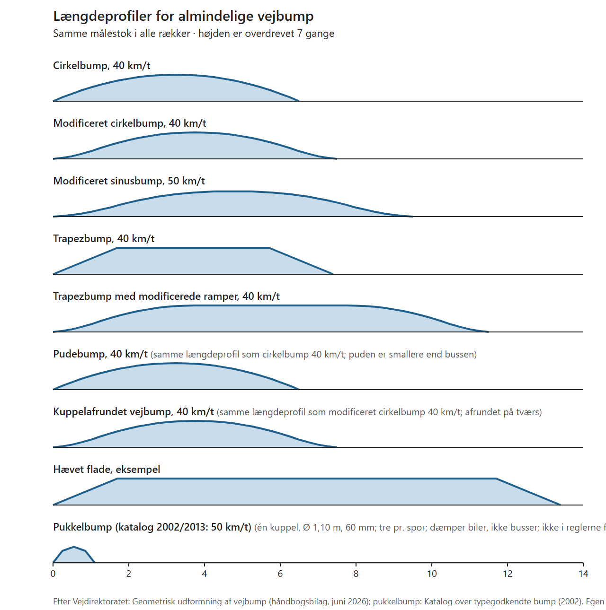

# Kilder: regler, vejledninger og ældre målinger om vejbump og busser

Brug denne oversigt, når en analyse skal bruges i en konkret sag (fx over for en kommune): hvilke regler gælder for bumpet, er det udformet rigtigt, hvad anbefales på veje med busser i fast rute, og hvad viser ældre målinger af fart, G-påvirkning og påvirkning af chauffører.

- **Status er tjekket på vejregler.dk 2026-11-11.** Tjek igen, før du citerer en kilde i en sag: vejregler ændres, og et dokument kan blive afløst. Ret "Sidst tjekket" her, når du har gjort det.
- PDF'erne følger ikke med pakken (ca. 60 MB). Hent de gældende fra vejregler.dk via linket; de øvrige skal du selv skaffe hos udgiveren (de deles ikke her). Gem dem lokalt i din projektmappe, fx `kilder\`.
- **Gælder kun det, der står som "Gældende".** Ældre rapporter er baggrund og historiske målinger, ikke regler.
- Kodeagent: læs indholdsfortegnelsen her, og åbn derefter kun de afsnit, du skal bruge (store PDF'er: konvertér til tekst først, fx med `markitdown`).

## Overblik

| # | Kilde | Udgiver, år | Status (vejregler.dk) | Sidst tjekket | Brug til |
|---|---|---|---|---|---|
| 1 | Håndbog **Fartdæmpere** | Vejdirektoratet, juni 2026 | Gældende (publiceret 25/06/2026) | 2026-11-11 | Valg, placering og anvendelse af bump og indsnævringer; bump på busruter |
| 2 | Håndbogsbilag **Geometrisk udformning af vejbump** | Vejdirektoratet, juni 2026 | Gældende (publiceret 25/06/2026) | 2026-11-11 | Bumptyper, mål og passagehastighed for busser; lovkrav (BEK 228/2026) |
| 3 | Idékatalog **Hastighedstilpasning i åbent land** | Vejdirektoratet, november 2014 | Gældende (publiceret 09/12/2014) | 2026-11-11 | Bump, indsnævringer m.m. uden for byerne |
| 4 | Håndbog **Kollektiv bustrafik og BRT** | Vejdirektoratet, august 2023 (rettelser til 19/12/2025) | Gældende (publiceret 08/01/2026) | 2026-11-11 | Busser på fartdæmpede veje |
| 5 | Notat **Hastighedsmålinger over bump** | Rambøll for Vejdirektoratet, februar 2013 (V3) | Ikke en vejregel; historisk | ikke tjekket online | Målt fart og G-påvirkning over 21 bump (personbiler) |
| 6 | **Undersøgelse af vejbumps påvirkning på erhvervschauffører** | SiD og Aalborg Universitet, 1999 | Ikke en vejregel; historisk | ikke tjekket online | Målt påvirkning af buschauffører over bump |
| 7 | Oplæg **Nye krav til vejbump** | Vejdirektoratet, Vejman.dk årsmøde 9/10/2025 | Høringsversion; afløst af BEK 228/2026 | ikke tjekket online | Baggrund for de nye regler; klodsmetoden |
| 8 | **Katalog over typegodkendte bump** | Vejdirektoratet og Vejregelrådet, september 2002 og september 2013 | Afløst (seneste udgave oktober 2019; typegodkendelse ophørt 1/2/2026) | 2026-11-11 (hentet) | Historiske bumptyper, bl.a. pukkelbump |

**Lovgrundlaget** er *Bekendtgørelse om vejbump og andre fartdæmpere*, BEK nr. 228 af 29/01/2026, i kraft 1/2/2026 (Lovtidende A 2026, https://www.lovtidende.dk/api/pdf/255257; læst 2026-11-11). Den ophæver BEK nr. 620 af 17/06/2019 og gælder kun ved **nyanlæg og ombygning** (§ 1); eksisterende bump er ikke omfattet. Den definerer trapezbump, cirkelbump, buet bump, præfabrikeret bump og variabelt bump (§ 2), og kravene står i §§ 3-13 og bilag 1 (tabel 1-4, figur 1). Typegodkendelsen af vejbump ophørte 1/2/2026, og *Katalog over typegodkendte vejbump* er afløst af kilde 2. Kilde 4 henviser stadig til den gamle bekendtgørelse (BEK 620) og kataloget fra 2019; brug BEK 228 og kilde 1 og 2 for reglerne.

## Bumptyper (tegninger)

Egne tegninger efter tabelværdier og mål i kilde 2 (egen optegning, ikke Vejdirektoratets figurer). Den enkelte bumptype er tegnet i samme format som kilde 2's figurer: længdeaksen spænder over bumpets længde, højdeaksen går fra 0 til 125 mm, og plotfladen har fast størrelse (ca. 6-7 gange overhøjning ved bump på 6,5-7,5 m, mere ved længere bump; tallet står på hver tegning). Oversigten har samme målestok i alle rækker og 7 gange overhøjning, så længderne kan sammenlignes; pude- og kuppelbump står med, med den længdeprofil bilaget angiver for dem (cirkelbump 40 km/t hhv. modificeret cirkelbump 40 km/t). Pudebumpet er desuden en plantegning i rigtige proportioner, og kuppelbumpet et tværsnit i samme format som de andre; bilaget angiver kun afrundingens bredde, så kurven i siderne er antaget. De kan bruges i rapporter og i `nationale_analysekonklusioner.md` med kildeangivelsen, der står på tegningen. SVG og PNG i [bumptyper/](bumptyper/); scriptet [tegn_bumpprofiler.py](tegn_bumpprofiler.py) laver SVG'erne igen.

| Bumptype (kilde 2) | Tegning | Længde ved 40 km/t | Passagehastighed for busser og lastbiler |
|---|---|---|---|
| Cirkelbump (bilag 1-1 til 1-5) | [cirkelbump_40](bumptyper/cirkelbump_40.png) | 6,5 m, 100 mm | 25 km/t (ved 40 km/t-bump) |
| Modificeret cirkelbump (bilag 2-1 til 2-6) | [modificeret_cirkelbump_40](bumptyper/modificeret_cirkelbump_40.png) | 7,5 m, 100 mm | 25 km/t |
| Modificeret sinusbump (bilag 3-1, findes kun til 50 km/t) | [modificeret_sinusbump_50](bumptyper/modificeret_sinusbump_50.png) | 9,5 m, 95 mm (50 km/t) | 35 km/t (ved 50 km/t-bump) |
| Trapezbump (bilag 4-1 til 4-4) | [trapezbump_40](bumptyper/trapezbump_40.png) | 7,4 m, rampe 60 ‰ | 20 km/t |
| Trapezbump med modificerede ramper (bilag 5-1) | [trapezbump_mod_ramper_40](bumptyper/trapezbump_mod_ramper_40.png) | 11,5 m, 100 mm | 25 km/t |
| Hævet flade (trapezbump med plan flade på mindst 10 m, afsnit 2.9) | [haevet_flade_40](bumptyper/haevet_flade_40.png) | eksempel | som trapezbump |
| Pudebump (bilag 6-1) | [pudebump_40](bumptyper/pudebump_40.png) (set ovenfra) | puder 6,5 × 1,9 m på 6,0 m kørebane | 40 km/t (busser kan køre med hjulene på hver side af puden) |
| Kuppelafrundet vejbump (bilag 7-1) | [kuppelafrundet_40](bumptyper/kuppelafrundet_40.png) (tværsnit) | afrunding 1,0-1,5 m i hver side | 25 km/t |
| Pukkelbump ("mushroom"; kilde 8, bilag 5-1, ikke i reglerne fra 2026) | [pukkelbump_50_tvaersnit](bumptyper/pukkelbump_50_tvaersnit.png), [pukkelbump_50_plan](bumptyper/pukkelbump_50_plan.png) | 6 paddehatteformede kupler, tre forskudt i hvert spor, Ø 1,10 m, 60 mm høje; ønsket hastighed 50 km/t | ikke angivet; typen skal dæmpe personbiler, ikke busser og lastbiler (krav: under 0,5 G for tunge køretøjer) |

**Pukkelbump i dag.** BEK 228/2026, kilde 1 og kilde 2 nævner ikke pukkelbump, og vi har ikke fundet et nyt navn for typen. Katalogerne fra 2002 og 2013 har kun én variant (50 km/t, 60 mm); højere runde bump, man ser på vejene, er altså ikke katalogets pukkelbump, men kan være andre eller præfabrikerede bump (2013-kataloget havde 10 typegodkendte præfabrikerede bump, bilag 9-1 til 9-10, ikke gennemgået) eller ældre/ikke-godkendte udførelser. Katalogets tegning viser kuplerne forskudt (to mod midten, én mod kantstenen i hvert spor); indsnævring er ikke et krav, men bump kan ifølge kataloget bruges både i to spor og ved indsnævring til ét spor, og steler ved kantsten er valgfri. *Egen læsning, ikke bekræftet af Vejdirektoratet:* en pude på 1,10 m i vejens længderetning er et bump på mellem 0,7 og 1,7 m, så et nyt pukkelbump må efter § 7, stk. 2 kun anlægges, hvor planlægningshastigheden er højst 30 km/t (højst 6 cm højt, § 5; præfabrikeret højst 200 ‰ hældning, § 12). Eksisterende pukkelbump er ikke omfattet (§ 1). Kilde 3 (2014) nævner pukkelbump som en mulighed på veje med busser i fast rute; kilde 4 skriver, at erfaringerne er blandede. Ikke gennemgået, men kan have mere: Vejdirektoratets *Kontrolmåling af vejbump* (bilag til kilde 1), Københavns Kommunes *Bump og anden fartdæmpning på vej* (2023) og Trafitecs *Erfaringsopsamling om trafiksanering med hastighedsdæmpning: Vejbump* (2023).

Passagehastigheden er den fart, kilde 2 anbefaler for tunge køretøjer, så føreren får et ubehag svarende til en personbilist ved bumpets planlægningshastighed. Den er typisk 15-20 km/t lavere end planlægningshastigheden.

## 1. Håndbog Fartdæmpere (juni 2026)

- **Link:** https://vejregler.dk/h/7e0fba84-06dd-483b-898a-c7b3e3affaa1/900dfdd943b5481f8d8522f40f0eeda1?showExact=true
- **Fil:** `Håndbog_Fartdæmpere_juni2026.pdf` (80 sider). Erstatter håndbogen fra maj 2013. Vejregelgruppe: Byernes trafikarealer.
- **Indhold:** 1 Indledning · 2 Grundlag (2.1 Lovgivning, 2.2 Standarder, vilkår, håndbøger) · 3 Planlægning og forudsætninger (3.1 Hastighedsplanlægning, 3.2 Valg af hastighed og skiltning, 3.3 Procedure for valg og placering, 3.4 Planlægningsforudsætninger, 3.5 Stræknings- og områdeskitse, 3.6 Overordnede typer af fartdæmpere, 3.7 Valg af fartdæmpere, 3.9 Placering og afstand mellem fartdæmpere, 3.10 Kørearealer gennem fartdæmpere, 3.11 Cyklister, 3.12 Tavleplacering, 3.13 Belysning, 3.14 Steler og hegn, 3.15 Vedligehold) · 4 Visuelle fartdæmpere (4.1-4.6) · 5 Vejbump (5.1 Typer, 5.2 Geometrisk udformning, 5.3 Anvendelse, 5.4 Placering, 5.5 Afmærkning og tydelighed, 5.6 Materialer, 5.7 Drift og vedligehold, 5.8 Kontrolmålinger, 5.9 Effekt, økonomi og gener) · 6 Indsnævringer og forsætninger (6.1 Typer, 6.2 Forsætninger, 6.3 Indsnævringer, 6.4 Midterheller, 6.5 Midterarealer, 6.6 Sideheller, 6.7 Indsnævringer til 1 spor, 6.8 Afmærkning, 6.9 Effekt, økonomi og gener) · 7 Kombination af forskellige fartdæmpere (7.1-7.4) · 8 Fartdæmpere for cykler og knallerter (8.1-8.6) · 9 Referenceliste · 10 Bilagsoversigt.
- **Bilag** (selvstændige dokumenter): Håndbogsbilag *Geometrisk udformning af vejbump* (kilde 2); Håndbogsbilag *Kontrolmåling af vejbump* (ikke hentet).
- **Særligt for busser:** afsnit 5.3.1 *Veje med busser i fast rute*: vejbump bør undgås på veje med busser i fast rute (chaufførers arbejdsmiljø, helkropsvibrationer, øget køretid og driftsomkostninger, passagerkomfort); kan det ikke undgås, anbefales busvenlige bump som pudebump eller modificerede cirkelbump (50 km/t). Afsnit 3.9: mindst 25 m mellem kryds og bump, hvis bussen drejer i krydset.

## 2. Håndbogsbilag Geometrisk udformning af vejbump (juni 2026)

- **Link:** https://vejregler.dk/h/7e0fba84-06dd-483b-898a-c7b3e3affaa1/344c206b7b9d4c0692a468af3e8522cd?showExact=true
- **Fil:** `Håndbogsbilag_Geometrisk udformning af vejbump_juni26.pdf` (30 sider). Bilag 1 til kilde 1. Erstatter *Katalog over typegodkendte vejbump*; ændret i forhold til udgaven fra februar 2026 (60 km/t-bilag tilføjet, pudebumps bredde ændret).
- **Indhold:** 1 Indledning (1.1 Terminologi, 1.2 Væsentlige ændringer) · 2 Udformning af vejbump (2.1 Vejens jævnhed, 2.2 Planlægningshastighed, 2.3 Højde, 2.4 Lodrette, opadgående spring, 2.5 Tværgående hældninger, 2.6 Cirkelbump, 2.7 Modificerede cirkelbump, 2.8 Modificerede sinusbump, 2.9 Trapezbump, 2.10 Trapezbump med modificerede ramper, 2.11 Pudebump, 2.12 Kuppelafrundede vejbump, 2.13 Variabelt vejbump, 2.14 Præfabrikerede vejbump).
- **Bilag:** 1-1 til 1-5 Cirkelbump 20/30/40/50/60 km/t · 2-1 til 2-4 og 2-6 Modificeret cirkelbump 20/30/40/50/60 km/t · 3-1 Modificeret sinusbump 50 km/t · 4-1 til 4-4 Trapezbump 20/30/40/50 km/t · 5-1 Trapezbump med modificerede ramper 40 km/t · 6-1 Pudebump 40 km/t · 7-1 Kuppelafrundet vejbump 40 km/t. Hvert bilag har længdeprofil, højde pr. 0,25 m og passagehastighed for tunge køretøjer.
- **Lovkrav (BEK 228/2026, citeret):** udformning skal passe til planlægningshastigheden (§ 4); maks. højde 10 cm for bump på 3 m eller mere (§ 5); ingen lodrette spring over 5 mm (§ 6); tværhældning højst 1:3 (§ 8); trapezbumps rampehældning højst 140/100/60/40 ‰ ved 20/30/40/50 km/t (§ 9); cirkelbump mindst 3/4/6,5/9,5/11,5 m ved 20-60 km/t (§ 10); ingen fordybninger over 2 cm inden for 2 m før og efter (§ 3).

## 3. Idékatalog Hastighedstilpasning i åbent land (november 2014)

- **Link:** https://vejregler.dk/h/7e0fba84-06dd-483b-898a-c7b3e3affaa1/e309eec0e89c4cdca1abcb72412f6b9b?showExact=true
- **Fil:** `Hastighedstilpasning i åbent land.pdf`. Vejregelgruppe: Veje og stier i åbent land.
- **Indhold:** 1 Indledning (1.1 Idékatalogets status, 1.2 Hastighedstilpasning, 1.3 Indhold) · 2 Områder (2.1 Hastighedszone) · 3 Strækninger (3.1 Lokale hastighedsgrænser, 3.2 Skiltning på uheldsbelastede strækninger, 3.3 2+1 veje, 3.4 2÷1 veje, 3.5 Smallere kørespor, 3.6 Bredere kantbaner, 3.7-3.9 midterrabat, smal midtervulst, overkørbart midterareal, 3.10 Advarselsheller, 3.11 Bump, 3.12-3.18 linjer, rumleriller, farvet belægning, kantafmærkning, beplantning) · 4 Kurver (4.1-4.5) · 5 Fra land til by (5.1 Hastighedsbegrænsning, 5.3 Midterheller, 5.4 Indsnævring, 5.5 Forsætning, 5.6-5.10) · 6 Punkter på strækningen (6.1-6.14, bl.a. indsnævring, 6.6 Bump, 6.10 Porte, 6.11 Fartvisere) · 7 Vejkryds (7.1-7.14, bl.a. 7.10 Bump, 7.11 Indsnævring) · 8-9 (bl.a. afmærkning).
- **Særligt:** 3.11 Bump: kun sjældent på fri strækning i åbent land, op til 60 km/t, og modificerede cirkelbump anbefales af hensyn til kørselskomforten.

## 4. Håndbog Kollektiv bustrafik og BRT (august 2023, rettelser til 19/12/2025)

- **Link:** https://vejregler.dk/h/7e0fba84-06dd-483b-898a-c7b3e3affaa1/eafd592b2f364c93b4c42c97046c4aea?showExact=true
- **Fil:** `23-00171-69 Håndbog for Kollektiv Bustrafik og Bus Rapid Transit (BRT) - August 2023 inkl rettelser april 2024, juni 2024 og december 2025.pdf` (175 sider). Rettelser 16/4 og 20/6 2024, ændring 9/8 2024, rettelser 19/12 2025. Vejregelgruppe: Kollektiv trafik.
- **Indhold:** 1 Indledning (1.1 Referencer, 1.2 Terminologi, 1.3 Ændringer) · 2 Tekniske forudsætninger (2.1 Passagerernes forhold, 2.2 Bussernes dimensioner og arealbehov, 2.3 Konsekvenser) · 3 Fysisk udformning (3.1-3.12, bl.a. busbaner, busveje, bussluser, udfordringer for bustrafik, *busser på fartdæmpede veje*, busser i gå- og sivegader, geometriske forhold, kryds, tracering, tværprofiler) · 4 ITS-løsninger (4.1-4.3) · 5 Stoppesteder (5.1-5.6) · 6 Bus Rapid Transit (6.1-6.6) · 7 BRT på motorveje (7.1-7.6) · 8 Bilagsoversigt.
- **Bilag:** Eksempelsamling *Kollektiv bustrafik* (selvstændigt dokument, ikke hentet).
- **Særligt:** afsnittet *Busser på fartdæmpede veje* / *Busser og bump*: bump på veje med busbetjening bør så vidt muligt undgås; bump kan med fordel placeres ved stoppesteder. Henviser til den gamle bekendtgørelse og typekataloget, se ovenfor.

## 5. Notat Hastighedsmålinger over bump (Rambøll, februar 2013)

- **Fil:** `Hastighedsmålinger over bump.pdf`. Rambøll for Vejdirektoratet, ref. 12653148, V3 2012-12-29, rev. 2013-02-26.
- **Indhold:** Indledning · 2 slangemålinger i Gladsaxe · Slange- og lasermålinger · 21 slangemålinger · Opsamling · Bilag 1 Lasermålinger over bump (hastighedsprofiler, Gladsaxe og Hørsholm, 2012).
- **Fund:** 21 bump (30, 40 og 50 km/t), personbiler. Personbilers passagehastighed lå under eller omkring bumpets designhastighed; 85 %-fraktilen under designhastigheden på næsten alle 30- og 40 km/t-bump. G-påvirkning under 0,75 på alle på nær ét. Målt efter de gamle G-krav, før BEK 228/2026.

## 6. Undersøgelse af vejbumps påvirkning på erhvervschauffører (1999)

- **Fil:** `Undersøgelse af vejbumps påvirkning på chauffører.pdf`. Udgivet af SiD (marts 1999); målerapport fra Aalborg Universitet, Laboratoriet for Akustik, med Vejdirektoratet.
- **Indhold:** Forord fra SiD · Indledning · Målerapport (formål, måleforhold, konklusioner) · Måleprogram 1 Normal kørsel · 2 Kørsel med 0,7 g · 3 Kørsel uden bump · 4 Hastighedsafhængighed og nivellering · Supplerende analyse A Impulsholdige vibrationer · B Sammenligning af to målemetoder · Bilag 1 Projektbeskrivelse.
- **Fund:** bybuslinje i Aalborg med ca. 150 bump pr. arbejdsdag. Ved kørsel efter skiltningen var påvirkningen over den daværende anbefalede grænse (0,7 g) ved 78 % af bumpene, op til 4,1 g. 5 km/t højere fart gav typisk 2-5 gange kraftigere påvirkning. Køreplanen kunne ikke overholdes ved passage efter reglerne. Historisk: bumpene og reglerne var anderledes end i dag.

## 7. Oplæg Nye krav til vejbump (Vejdirektoratet, 9/10/2025)

- **Fil:** `Nye krav til vejbump.pdf` (29 dias). Oplæg på Vejman.dk årsmøde.
- **Indhold:** Status i dag (G-påvirkning, typegodkendelse) · De væsentligste ændringer i den nye bekendtgørelse · De nye krav (højde, tværgående hældning, trapezbump, cirkelbump, modificeret bump, vejens overflade) · Geometrisk opmåling og klodsmetoden · Afslutning.
- **Fund:** G-målinger af bump var usikre (2024: 9 af 34 målinger over 0,75 g, 23 under 0,65 g); kravet om G-påvirkning erstattes af geometriske krav; Vejdirektoratet må fra 2026 ikke G-måle bump for kommuner; klodsmetoden til egen kontrolmåling. **Høringsversion:** enkelte tal (fx højdetabellen) afviger fra den vedtagne BEK 228/2026; brug kilde 2.

## 8. Katalog over typegodkendte bump (september 2002)

- **Link 2002 (kopi):** https://homes.plan.aau.dk/kjems/lectures/B3-2009/katalog_typegodkendte_bump.pdf (29 sider). **Link 2013 (kopi):** https://www.odsherred.dk/media/nv4maavv/typegodkendte_vejbump.pdf (53 sider; revideret 2004, 2007, 2008, 2009, 2010, 2011, 2012 og 2013). Vejdirektoratet og Vejregelrådet. Afløst: seneste udgave oktober 2019, og typegodkendelsen ophørte 1/2/2026 (kilde 2).
- **2002, forsiden** viser fem typer: cirkelbump, modificeret cirkelbump, modificeret sinusbump, trapezbump og pukkelbump. **2013-indhold:** 1 Indledning · 2 Funktionskrav (2.1 generelle, 2.2 andre, bl.a. pukkelbump, 2.3 godkendte, 2.4 andre bump) · 3 Udformning (3.1 cirkelformede, 3.2 modificerede cirkelbump, 3.3 modificerede sinusbump, 3.4 kuppelformede, 3.5 trapezformede, 3.6 trapez med modificerede ramper, 3.7 kombibump, 3.8 pudebump, 3.9 pukkelbump, 3.10 præfabrikerede permanente, 3.11 midlertidige, 3.12 variable) · 4 Udførelse. Bilag: 1-1 til 1-7 cirkelbump 20-50 km/t, 2-1 til 2-7 modificerede cirkelbump 20-50 km/t, 3-1 modificeret sinusbump 50 km/t, 4-1 til 4-7 trapezbump 20-50 km/t, 5-1 pukkelbump 50 km/t, 6-1 trapezbump med modificerede ramper 40 km/t, 7-1 kombibump 30 km/t, 8-1 pudebump 40 km/t, 9-1 til 9-10 præfabrikerede permanente bump (20-40 km/t), 10-1 midlertidigt bump.
- **Bilag 5-1 Pukkelbump 50 km/t (samme i 2002 og 2013):** 6 paddehatteformede kupler, tre forskudt i hvert spor, diameter 1,10 m, 0,25 m mellem rækkerne, højde 60 mm (tværsnit pr. 5 cm, tolerance ±5 mm), placering efter kørebanens bredde (4,60-7,50 m), mindst 25 m fra vejkryds, afmærkes som almindelige bump. Funktionskrav: personbil 0,5-0,75 G, tungt køretøj under 0,5 G ved den ønskede hastighed; typen bruges, hvor personbiler skal dæmpes, men busser og lastbiler ikke.
